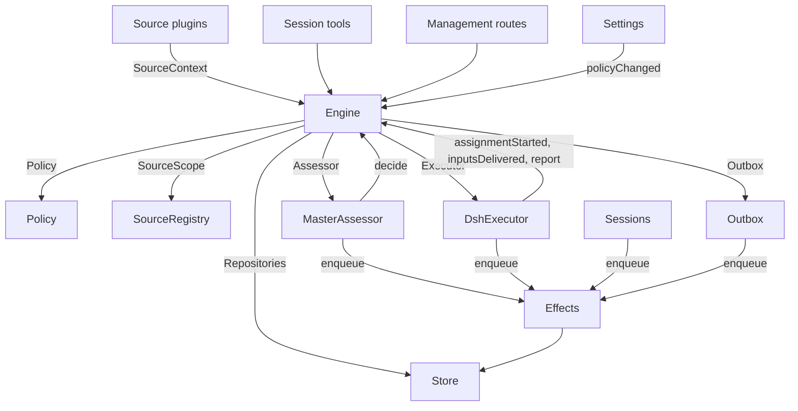

# 007 Architecture

This is the developer guide to the implementation. It maps the concepts in [001 Domain model](001-domain.md) through [006 Deployment](006-deployment.md) to classes, interfaces and files. Start with the runtime and Engine, then use the module and test tables as a code index.

## Core classes and glue

Core classes own domain concepts and external boundaries behind small interfaces. Glue translates tool arguments, HTTP requests, Source payloads and DeepSeek Harness events into calls to those classes, then turns results into cards, views and messages.

`Runtime` (`src/app/runtime.ts`) constructs the application, supplies dependencies, and owns startup and shutdown. `Engine` constructs its own internal parts. The Executor and Assessor call back into the Engine, so Runtime gives them getters rather than requiring construction in a circular order.

### Runtime

`Runtime` is the composition root; it contains no domain rules. Its constructor locks the state directory, opens the Store and builds each component. If construction fails, it closes the Store and releases the lock.

Startup registers management routes and runs Setup. After setup resolves, it installs Session and Executor hooks, ensures the main Session exists, starts Policy syncs, resumes interrupted Assignments, and starts passes and effects. `ready` marks completion of startup.

Shutdown cancels turns, waits for passes, effects and agents, restores the process environment, closes the Store and releases the lock. Source plugins inject Runtime as the `orchestrator` service through the narrow `SourceHost` interface.

| Part | Module | Does |
| --- | --- | --- |
| Setup | `src/app/setup.ts` | Resolves the repository and the accounts by probing their CLIs the way worker shells run them, writes and applies the workers' environment and command shims, and keeps the setup problems; Settings checks a changed account through it, and restarts through it, which runs setup again |
| Passes | `src/app/passes.ts` | One pass at a time, every two seconds and whenever a command asks: the due effects, then `Engine.evaluateDue`; a Source's Trigger reaches the Engine through it |
| Outbox | `src/app/outbox.ts` | The Engine's `Outbox` port, and the only writer of the receipts: `send` keeps a message's receipt and queues its `reply` effect in one transaction, and the effect's handler sends it through `SourceRegistry.send`; a message waits while its Source is off, and is dropped when the conversation is gone or not listened to |
| Notices | `src/app/notices.ts` | Converts domain events and worker activity into main-Session messages. `eventNotice` handles domain notices; `reportRelay` forwards questions immediately, keeps ordinary progress on its Ticket, and relays other reports; `followupRelay` names the Tickets that own a human follow-up. Relays arriving during a turn are delivered together at its next step through the DeepSeek Harness inbox |

### Engine

`Engine` (`src/core/engine.ts`) is the only writer of Triggers, Threads, Decisions, Tickets and Assignments. It receives these ports from `src/core/ports.ts`: `Repositories`, a current-Policy getter, `SourceScope`, `Assessor`, `Executor` and `Outbox`. Optional dependencies are `prepareTicket`, `now` and `emit`.

All Engine methods are synchronous. Each command changes its aggregates in one transaction. `evaluateDue` uses a separate transaction for each Eval or Ticket it changes. Ports enqueue external work inside the transaction; adapters perform it after commit. Invalid requests throw `UserError`.

The Engine exposes one entry point and delegates to five internal parts. It owns each command's transaction. Commands spanning parts, such as `attach`, `evaluateDue` and `policyChanged`, call the parts in sequence.

Each part extends `EnginePart` (`src/core/part.ts`), which provides options and shared reads. Dependencies between the parts flow in one direction:

| Part | Responsibility | Depends on |
| --- | --- | --- |
| `Intake` | A Source's Trigger: stored once with its disposition, recorded on its Threads and their correlations, fanned out to the subscribed Tickets and, unless it is a person's message that reached one, queued for Eval on its primary Thread | Tickets |
| `Evals` | The Evals of Threads: batching, the gate's strength, actor and basis with the Trigger that gave them (`primary`), the deadline from the candidate's delivery and its shift by a pause, the requeue of an expired Eval, candidates, replays and hand-backs, the requeue on a Policy change, and the Decision each ends with: accept, chat, stop, ignore or unavailable. 一条 `chat` 先把回复排进答复通道，带 `escalation` 时再走 accept 的建单路径（`startTicket`），因此两条路只有决策的 kind 与 `escalation` 字段不同 | Tickets, Replies |
| `Tickets` | The Ticket lifecycle: creation from an accept with its Mandate, Subscriptions and first Assignment, the Threads it follows and their closes (`followsDone`), attached Threads and Threads followed for context, Inputs and notes, resume and the messages a resume refuses, retry, restart, stop and end, the Subscriptions it drops, and the notice of a Policy change to the Tickets it bears on | Replies |
| `Assignments` | What the Executor and its workers report: an Assignment started, Inputs reached it or failed to, a restart interrupted it, and a worker's Report with its question for a person | Tickets, Replies |
| `Replies` | Channel writes through the `Outbox`: the acknowledgement, the answer, the result, the attention message and a chat Decision's reply, each by the rule that allows it | Nothing |

Commands use imperative names such as `stopTicket`; facts reported by adapters use past-tense names such as `assignmentStarted`. The query `candidate` uses a noun.

Callers receive only their role's `Pick` of the Engine: `EngineForSources`, `EngineForMainSession`, `EngineForPeople`, `EngineForSettings` or `EngineForExecutor`.

| Role | Method | Effect |
| --- | --- | --- |
| Sources | `receive(trigger)` | Stores a Trigger once and answers `stored`, `duplicate`, or `filtered` when no Source receives it; fans it out to the Tickets subscribed to its Threads, where a person's message resumes an ended Ticket at once unless processing is paused, and queues it for Eval on its primary Thread, unless it is a person's message that reached a Ticket, which stays that Ticket's |
| Sources | `bindThread(ticketId, thread, own)` | Makes an open Ticket follow one of the Source's Threads, such as a pull request's, `own` when the Ticket opened it; a closed Thread bound again is open again. The Threads' closes, not a `ready` Report, end the Ticket |
| Sources | `threadClosed(thread, outcome, at)` | A Thread closed: each open Ticket that follows it records the close, and ends once it is done with the Threads it follows (`followsDone`): no Thread it opened is open, or, when it opened none, every Thread it follows closed. It ends `merged` or `closed` as the latest of those closes did, unless work resumed after the close has not reported `ready`, or its Executor took up, by acknowledging or answering it, a person's follow-up it decides after its latest Report other than `progress`, or the end of its last turn; a `dropped` Report then ends it as the close did |
| Main Session | `candidate(triggerId)` | The Eval that holds a Trigger, as its assessor sees it |
| Main Session | `candidateDelivered(evalId)` | The Eval's candidate reached the main Session: its deadline counts from now |
| Main Session | `decide(triggerId, outcome)` | Records an Eval Decision, or a direct Decision for an explicit request. Accept creates the Ticket, Mandate, Assignment, Subscriptions and acknowledgement atomically. An inferred candidate ignored from its card records `ignoredFromCard` before the supplied reason. While `followupOwners` still owns a human follow-up, only stop is allowed |
| Main Session | `attach(ticketId, triggerId, note?)` | Routes a Trigger to a Ticket it points at, whose Executor then decides it as a follow-up, and ends the Eval that holds it, whose other Triggers wait for a fresh Eval; an ended Ticket resumes under its Mandate at once unless processing is paused. A follow-up an Executor still decides is refused, as is one routed back to the Ticket that handed it back |
| Main Session | `requestStatus(ticketId)` | Asks a waiting Executor Session for its status, and answers whether it asked |
| Main Session | `note(ticketId, text)` | Gives a Ticket's Executor a fact from other work as a text Input, which grants nothing |
| Main Session, Executor | `reply(request)` | Queues a message for the Channel its purpose names: `acknowledgement`, `answer`, `result` or `attention` |
| People | `stopTicket(ticketId, reason?)` | A person's stop, which withdraws the Mandate |
| People | `retryTicket(ticketId)` | Ends the stalled Assignment of a Ticket that waits for a person after a `failed` or `blocked` Report, or whose Input delivery failed (`canRetry`), and starts a new one |
| People | `reevaluate(triggerId)` | Queues a stored Trigger for a fresh Eval |
| People | `unsubscribe(thread)` | Drops every Subscription on a Thread, and the Tickets that followed it follow it no more; each keeps deciding the follow-ups it received there |
| People | `dismiss(decisionId)` | Dismisses the problem an `unavailable` Decision shows, which the Decision records |
| Executor | `assignmentStarted(ticketId, assignmentId)` | An Assignment runs; its waiting Inputs go out |
| Executor | `inputsDelivered(ticketId, assignmentId, inputIds)` | Inputs reached the Assignment's Executor Session, where each waits for a step to take it |
| Executor | `inputsRead(ticketId, inputIds)` | The Executor Session took the messages that carry these Inputs into its history (a `user/message` Session event), from which its model has them; a step that claimed them and was cancelled or failed before does not count. Each counts as read once a Report or the end of a turn follows, also after a restart, and its Ticket's end does not let go of it; an Input delivered before reads were recorded counts as read once a Report or the end of a turn followed its delivery |
| Executor | `turnEnded(ticketId, assignmentId)` | A turn of the Executor Session ended, also after a Report, once nothing runs for it in the background or as it hands off to a person. What a step took before, it read (`inputsRead`) |
| Executor | `deliveryFailed(ticketId, assignmentId, error)` | Delivering Inputs failed; the Ticket shows it until a delivery succeeds, a new Assignment starts or the Ticket ends |
| Executor | `report(ticketId, report)` | Records a Report and its question for a person; `dropped` ends the Ticket, and `ready` completes one that follows no Thread, and ends one done with the Threads it follows as they ended |
| Executor | `markUnrelated(ticketId, thread, reason)` | Drops only that Ticket's Subscription to an attached Thread it found unrelated, and hands back, with the reason, the follow-ups there that the Ticket decides |
| Executor | `followForContext(ticketId, thread)` | Subscribes an open Ticket to a related Thread for context: its messages reach the Ticket but lend it no follow-up strength and do not resume it |
| Executor | `handback(ticketId, triggerId, reason)` | Records that the Ticket hands back a Trigger that reached it, with the reason its candidate carries, and queues it for a fresh Eval once no other Ticket decides it, if this Ticket did; it answers whether it queued it. A Ticket hands back each Trigger once and keeps its Subscription |
| Executor | `assignmentInterrupted(ticketId, assignmentId)` | An Assignment was running when the host stopped: one interrupted mid-work, or one that received an Input after its latest Report, starts again with a recovery note and the Inputs delivered to it that its Executor Session did not take, as a retry does; one that had reported since keeps its Session. The DshExecutor reports each at start (`resume`), oldest Ticket first, and queues again a launch that waits |
| Passes | `evaluateDue()` | Unless processing is paused: starts the Evals of the Threads whose queued Triggers wait, one per Thread with the Triggers queued meanwhile as one batch; queues the Triggers of an Eval past its deadline again, twice in a row, and records it `unavailable` the third time; and resumes the ended Tickets a person's message reached during a pause, if their Mandates still hold. An Eval whose candidate has not reached the main Session does not expire. While processing is paused, no Eval expires, and once it resumes each deadline moves later by the pause's length |
| Settings | `policyChanged(from, to, effects)` | Tells each live Ticket the change bears on how (`policyEffects` in `src/policy.ts`: a rule it was accepted under changed or no longer applies, its requester may no longer start work, or proactive work is no longer accepted), and restarts the Evals in progress under the new version |

The Engine keeps batching, authorization, fan-out, resume and attention lifecycle rules private. Several shared predicates make these rules consistent:

- `waitsForPerson` (`src/core/model.ts`): the latest Assignment reported `blocked` or `failed`, and no human message has arrived since. Automatic Inputs and failed launches remain held while this is true.
- `followupOwners`: the Tickets still responsible for a human follow-up received on their own Threads. A Ticket can be live or ended without a human stop and waiting to resume. Handing back the message ends that ownership.
- `settled`: a Decision resolved the request; stop, unavailable, routed and refused-stop Decisions do not count.
- `ticketStage` (`src/core/stage.ts`): implements the stage table in [003 Execution](003-execution.md).

When a Ticket ends, unread follow-ups return to Eval unless another Ticket still owns them or another disposition settled them. Acknowledged, answered and handed-back messages are excluded. For older records without acknowledgement dispositions, the outbox receipt supplies that fact. A final Report also covers messages waiting when the Assignment began, including the message that resumed it. The message that stopped a Ticket is not automatically re-evaluated.

After a change, the Engine emits an event from `DomainEvents` in `src/core/ports.ts`:

`trigger.received`, `eval.started`, `decision.recorded`, `ticket.created`, `ticket.resumed`, `ticket.ended`, `assignment.started`, `assignment.ended`, `thread.subscribed`, `thread.unsubscribed`, `trigger.requeued`, or `policy.changed`.

Runtime turns `ticket.ended`, `trigger.requeued` and `thread.unsubscribed` into notices. A human `trigger.received` delivered to Tickets becomes a follow-up relay. `pullEndNotices` sends one chat notice, using a stable id, when a Ticket ends merged or closed. Other events currently have no consumer.

### Model

`src/core/model.ts` holds the domain types, and `src/core/stage.ts` the Ticket stages. A Decision records why as `reason`, a list of `Reason`s (`src/core/reasons.ts`): each a `code` with its `values` and, for one Trigger of a batch, its `triggerId`.

The core's codes, such as `timeout`, `policyChanged`, `routed` and `startedTicket`, are `REASONS`, with the English that agents read through `reasonText`; a gate or a Source scope gives its own, such as `not_a_member`; and `said` carries words an assessor or a person wrote. The panel words each code by `reason.<code>`, and a Trigger a Source filtered records the Source's code the same way.

A Ticket keeps each fact once. It is open while it has no `ended`, which records when, by whom, why and with what outcome it ended; what it last said is its latest Assignment Report (`latestReport`); and its Executor Session is named after it (`workerSessionId` in `src/executor/dsh.ts`).

Its fields are typed: `origin`, the admissible Trigger that gave its Eval's batch its strength and the batch itself (`triggerId`, `triggerIds`); `execution`, what the Executor chose (`name`, `directory` and `assignment`); `delivery`, the last failed Input delivery (`error`, `at`), until a delivery succeeds, a new Assignment starts or the Ticket ends; and `follows`, the Threads a Source made it follow, each `{thread, own, closed?}`: `own` when the Ticket opened it, and `closed` with `at` and `outcome` once it closed. Tickets alone writes `follows`; the GitHub Source reads its pull requests with `pullsOf` and `pullOf` (`src/sources/github-pull.ts`).

An Input that carries a Trigger records whether a person wrote it, which `waitsForPerson` reads. A Thread also lists in `context` the subscribed Tickets that follow it only for context, and counts in `expired` the Evals of its queued Triggers that expired in a row; an Evaluation records its `primary` Trigger and when its candidate was `delivered`.

A Trigger's disposition records the Tickets it reached, by fan-out or attachment, a person's requeue, each Ticket that handed it back, with the reason, and each Ticket whose Executor acknowledged or answered it.

A Mandate's `basis` (`MandateBasis`) records how the gate admitted its Trigger. Revalidation reads the receiving `source`, `scope` and `row`, the listed `sender`, matched `rules`, and `via`:

| `via` | Admission basis |
| --- | --- |
| `addressed` | An allowed sender addressed the agent |
| `followup` | A message arrived on a Thread with Tickets |
| `admission` | An admission-table cell; `observation` marks an inferred candidate |
| `bot` | A listed bot produced an inferred candidate |

Trigger and Thread `meta` belong to the Source. The core does not interpret them.

### Policy

`src/policy.ts` defines settings schemas, authorization and assessment rules. `settingsPolicy(settings, scope)` returns a fresh, stateless `Policy` on each use:

- `version`, `paused` and `evalTimeoutMs` describe its current state.
- `gate(trigger, thread, tickets)` returns admission strength and basis.
- `revalidate(mandate)` checks whether an existing Mandate still holds.
- `admitsInferred(rules)` permits proactive acceptance only in auto mode with enabled matching rules.

`assessmentOutcome(assessment, settings, strength)` converts the model's assessment to an Engine outcome. It requires a judgement for every enabled rule, settled direction, a matching rule and evidence of intent. Outside auto mode, an inferred accept becomes a “would accept” record.

`policyEffects(tickets, old, now, scope)` identifies which open Tickets a change affects and how. `Engine.policyChanged` notifies only those Tickets. `policyVersion` hashes rules, accept mode and the Sources' Policy parts, including bot lists.

### Store

`Store` (`src/app/store.ts`) owns one SQLite database. Runtime acquires the directory lock before opening it, preventing a second process from migrating or writing the same state.

Its interfaces are grouped by purpose:

- **Domain repositories:** `atomic`, plus `triggers`, `threads`, `tickets` and `decisions`, each with `get`, `save` and list queries. Indexed working sets are `threads.active()`, `tickets.open()`, `tickets.active()` and `read.subscribedThreads`.
- **Read queries:** `read` serves views, tools and Source polls through methods such as `threadTriggers`, `triggerStats`, `search` and `droppedReplies`. These methods never write.
- **Source metadata:** `threads.describe` and `threads.patchMeta` update Source-owned Thread metadata.
- **Settings:** `settings`, `saveSettings`, `blockRevision` and `settingsHistory`. Settings and prompts use numbered `Versions` (`src/app/versions.ts`).
- **Outbox receipts:** `replyStatus` and `receipts`, written only by Outbox. Receipt operations are `get`, `waiting`, `behind`, `add`, `settle` and `withdraw`. `behind` checks whether an earlier message for the same Ticket and conversation is waiting with fewer than three failures. A withdrawn message settles with `channelGone` or `channelIgnored`. Read queries expose failed and dropped replies through `failingReplies`, `droppedReplies` and `droppedSince`.
- **Typed key-value records:** `get`, `set`, `delete` and `keys`, using entries from `KV`.

`afterCommit` runs an action only after the transaction commits, never after rollback. Runtime reads records in their stored shape; the schema 11 migration converts older supported records at startup.

### Effects

`Effects` (`src/app/effects.ts`) is the durable side-effect queue. A command calls `enqueue(kind, key, payload)` inside its transaction; execution begins only after commit.

Each kind/key pair has one row. Enqueuing the same waiting key replaces its payload and makes it due immediately without changing queue order. `handle(kind, run, options)` registers one handler per kind. It processes due rows oldest first, up to the concurrency limit.

Failures retry with exponential backoff. Throwing `Later` defers work without counting a failure, for example when no worker slot is available. Throwing `Rejected` says the payload itself was refused, such as arguments a CLI rejected: the row counts the failure and parks, keeping its payload, with no timer, until `retry(kind, key)` or the next `start`, which may run fixed code. `start` begins processing after setup, `drain` stops it during shutdown while preserving pending rows, and `pending`/`idle`/`parked` expose queue state.

| Kind | Handler | Does | At once | Retry |
| --- | --- | --- | --- | --- |
| `assessment` | MasterAssessor | Steers an Eval's candidate card into the main Session's turn, then tells the Engine it was delivered, which starts the Eval's deadline | 4, none while paused | 2 s doubling to 60 s |
| `launch` | DshExecutor | Launches a pending Assignment: prepare command, Executor Session, assignment message | The free worker slots, none while paused | A passing failure of the model provider or the network runs again after 5 s doubling to 300 s, three times; any other failure, and a failed prepare command, fails its Ticket. One held by a pause or by full worker slots tries again after 5 s |
| `delivery` | DshExecutor | Hands a Ticket's waiting Inputs to its running Assignment, in order | 4, none while paused | 2 s doubling to 60 s; one that waits for a worker slot tries again after 2 s |
| `relay` | Sessions | Steers a worker's report or question, or a person's follow-up, into the main Session's turn | 1, in queue order | 2 s doubling to 60 s |
| `notice` | Sessions | Injects a notice into the main Session without waking it | 1, in queue order | 2 s doubling to 60 s |
| `reply` | Outbox | Sends a message for a Channel through its Source, after the earlier messages of its Ticket to its conversation that have not failed three times; withdrawing the message cancels it | 1, none while paused | 5 s doubling to 300 s; one whose Source is off, or behind an earlier message, tries again after 5 s. One whose CLI refused its arguments (`validation`) parks, and no longer holds the later messages back |

Each kind has a health entry under its name. It reports an error once one of its effects failed three times in a row or parked, except `delivery`, whose failures show on their Ticket instead. Relays keep their order, and so do notices; a failed one holds back the later ones of its kind.

### Sources

Sources extend the host through `SourceKind`, defined in `src/sources/kind.ts`. A kind declares its identity, title, description, configuration `schema` and `fields`, derived `facts`, and `health` entries. Optional behavior includes `scope`, a `channel` (`allowed`, `send`, `link`), `threadContext`, `find`, `policy`, `environment` and `refreshLabels`.

`SourceRegistry` (`registry.ts`) owns registered kinds and stored instances, and implements the Engine's `SourceScope`. Registration claims health entries on `HealthBoard`; duplicate claims and reserved `sync:` names are refused. A SourceContext writes only through its registration's claimed entries, so reports after unregistration do nothing.

Registry configuration methods include `kind`, `instances`, `instance`, `validate`, `validatePolicy`, `policyPart`, `channelAllowed`, `declarations`, `environments`, `find` and `scope`. `find` asks each kind that supports search.

Generic code accesses Source behavior through the registry. `send(message, host)` calls the kind's Channel and returns `sent`, `gone` or `waiting` if the kind is not installed. `link` resolves its Channel link. `threadContext` pairs a kind's reader with its configuration, or returns nothing when the kind has no reader. Invalid stored configuration disables the instance.

Plugins receive `SourceHost`: the registry and `context(kind)`. The kind itself uses a narrower `SourceContext`, built by `sourceContextOf` in `src/app/source-context.ts`.

That context supplies deployment and commands, setup readiness (`ready`, `configured`, `problem`), configuration, `receive`, `admissible`, `atomic`, and typed `state`. It also exposes Thread reads and metadata writes, Ticket reads and binding/closure commands, Trigger reads with their dispositions, `notify` through Outbox, and `report` for declared health entries.

A Channel sends with the Source's own `state` too, so it can settle a record of that Source. Of `ChannelHost` that is the Feishu receipt reaction: taking a message the Policy admits adds the reaction and records which one it is, and that record is released exactly once — by the reply that settles, since the reply itself is the acknowledgement, or by the sweep that finds nothing will answer the message any more (`src/sources/feishu-receipt.ts`). A reaction therefore never outlives the reply it stands for, and a run that ended first leaves a record the next sweep releases.

### DshExecutor

`DshExecutor` (`src/executor/dsh.ts`) provides one Session and directory per Ticket. `start` and `deliver` enqueue `launch` and `delivery` effects. `stop` cancels the turn through `Store.afterCommit`, so a rolled-back end does not stop the worker.

`prepare(ticket, outcome)` supplies the Engine's `prepareTicket` hook: short name, directory and `ticketExecution` assignment text. `workerSessionId(ticket.id)` derives the Session id.

`WorkerSlots` reserves capacity before a launch or a delivery that wakes an idle worker. The limit is per delivery environment (the Ticket's recorded target, or the target its backend falls back to), and a human message can use one slot beyond `maxWorkers` in its own environment; wakes have priority over launches. `activeCount` supplies panel load.

Transient provider and network failures get three retries. Launches use effect backoff; failed turns receive continuation messages after 15, 30 and 60 seconds. `transient` decides what counts as passing: DeepSeek Harness's retryable failure codes (`RATE_LIMIT`, `SERVER`, `TIMEOUT`, `TRANSPORT`, `EMPTY_RESPONSE`) first, then an HTTP 408, 429 or 5xx or a connection failure; its terminal codes (`QUOTA`, `ACCOUNT_QUOTA`, `AUTH`, the credential codes, `CONTEXT_WINDOW_EXCEEDED`, `IMAGE_OFFLOAD_REQUIRED`) win over their message. A failure that outlasts those retries is the Watchdog's. `inputMessage` renders each Input from current Ticket state, and `mandateInstructions` adds the matched-rule limits for inferred work.

`install` subscribes to Session events; `dispose` unsubscribes. A turn end normally reports waiting, except after readiness or while human action is required. Errors report failed. At startup, `resume` reports interrupted Assignments through `assignmentInterrupted` and requeues pending launches that do not wait for a person, oldest Ticket first.

### MasterAssessor

`MasterAssessor` (`src/app/assessment.ts`) lets the main Session assess proactive candidates. `request` queues an assessment effect; `release` drops cached state when its Eval ends.

Its `context`, `read` and `decide` methods serve `orchestrator_eval`, `orchestrator_eval_read` and `orchestrator_eval_decide`. They provide bounded Thread context through `SourceRegistry.threadContext`, repository context, and decision submission. A kind without a context reader supplies only the Trigger and batch.

`assessmentOutcome` converts the model's answer for `Engine.decide`. Evals checks inferred acceptance against the current Policy again.

### Settings

`Settings` (`src/app/settings.ts`) reads and writes revisioned settings blocks. `current` and `view` read them; `save(block, value, revision, origin)` validates a save; `pause(paused, origin)` changes the separate `paused` setting.

Every save declares its origin: `panel`, `tool` or `sync`. Only `panel` can change the execution environment or fields listed in `SETUP_FIELDS` (`src/deployment.ts`).

A Policy-version change calculates `policyEffects`, records which Tickets were notified, and calls `Engine.policyChanged`. `syncable` and `sync(id)` refresh a Source's Policy part. `refreshLabels(id)` refreshes display names.

### Prompts

`Prompts` (`src/app/prompts.ts`) stores configurations as `Versions`. `current`, `version` and `history` read them; `validate`, `preview` and `save(value, baseRevision, source)` check and save them. `compose` and `skills` build Session text.

`builtInParts` lists override keys, roles, default text and required template placeholders. Each override stores team `text` and a `base`: the `builtInBase` key of its original default. Saves preserve that default under `KV.prompts.builtIn`. `defaultChanged` then reports changed defaults, their old text when available, and removed parts.

Validation inherits an omitted base from the saved override, drops removed parts already present in saved data, and rejects blank text or other unknown keys. This allows the save tool to round-trip a configuration it read. `environmentSection` and `policySection` substitute template values once, using own keys only. Configurations without overrides use defaults.

### Sessions

`Sessions` (`src/app/sessions.ts`) manages DeepSeek Harness Sessions for both roles. `ensure` creates a Session with its role's model. `install` follows agent events and registers prompts, skills and tools for managed Sessions.

`prompt` delivers once per request id. `relay` and `notify` enqueue main-Session messages handled by the `relay` and `notice` effects. `src/app/notices.ts` defines their content; `delivery` checks whether a message arrived.

Each model request binds the Session to the current prompt revision. The revisions it used are stored durably: `promptVersion` identifies the active one and `mayRead` restricts which versions a worker can inspect. Registrations are tracked in one map per agent.

`status` and `promptVersion` serve prompt pages. Saves go through `Prompts.save` and notify the main Session. `modelRetry` exposes model-budget retry state.

### Watchdog

`Watchdog` (`src/app/watchdog.ts`) recovers from a passing outage of the model gateway or the network. Its `poll` scans the open Tickets: a latest Report `failed` that `transient` counts as passing, a Ticket that still waits for a person and neither a question nor a failed delivery intervenes, is retried through `Engine.recoverTicket` after 1, 2, 5, 10, 15 and 30 minutes, up to twelve tries, the last delay repeated. The chain keeps its count across the host's own retries and starts again when a person retried; past its last try it waits for a person. `start` also watches the main Session: a turn that ended on such a failure is prompted to go on after the same backoff — a turn that ends as turns do clears the chain — and a main Session that disappeared is created again. The `watchdog` health entry names the pending recoveries, `status()` reports what is being recovered for `/orchestrator/api/state` and the Feishu status card, and `stop` waits for a scan in flight so none reaches a closed Store.

### Stall alert

`StallWatch` (`src/app/stall-watch.ts`) says once in a Ticket's conversation that it stopped making progress, so a person no longer has to ask. Once a minute it reads the open Tickets: a working one whose latest progress — its Assignment starting, a report, a turn ending, Inputs reaching it, or any event of its worker Session that `Activity` saw — is older than `executor.stall.minutes` (default 15), while no tool call of its worker runs (one running longer than an hour counts as hung) and no background work of its ended turn does, is stalled; so is one queued for a worker slot longer than `executor.stall.queuedMinutes` (default 30). A `P2`/`P3` Ticket the idle gate has not admitted yet is not that case: it waits for the system to become idle, by design and for as long as the mainline runs, so the gate's own verdict (`IdleScheduler.admission`) decides, and one it admits whose launch still never starts is reported like any other queued Ticket. Each stall queues one `notice` of at most three lines in the Ticket's reply conversation — how long, the last tool or the wait, and that the panel can retry or stop it — under an id made of the Ticket, its Assignment and the time of its last progress, so the Outbox sends it once and new progress starts a new count. `notify: false` keeps it to the `stall` health entry and `stall` in `GET /orchestrator/api/state` (`tickets`, `items`), which the Feishu status card shows as `N 张工单疑似卡住`. Nothing is announced while processing is paused, and the watch never changes a Ticket.

### Glue

| Glue | Translates |
| --- | --- |
| `src/app/runtime.ts` | The composition root: builds the parts with the interfaces they use, registers the routes and the Source host, and starts and stops dsh-superagent |
| `src/app/notices.ts` | Domain events and worker reports into notices and relays for the main Session |
| `src/app/tools/main.ts`, `src/app/tools/executor.ts` | Tool arguments of the main Session and the Executor Sessions into calls of the core classes, and their results into cards |
| `src/app/http.ts`, `src/app/views/`, `src/app/api.ts` | HTTP requests into calls, and Store reads into the panel's views; `api.ts` types every route for the panel |
| `src/app/resources.ts`, `src/app/links.ts`, `src/app/cards.ts` | Resource names into reads, source messages into links, records into compact cards for models |
| `src/sources/github*.ts`, `src/sources/feishu*.ts`, `src/sources/poll.ts` | GitHub and Feishu payloads into Triggers and Thread facts, and messages into CLI calls |
| `src/deployment.ts`, `src/setup.ts`, `src/infra/` | Setup probes and problems, CLI transport, the agent's process environment |

## Dependency rules

- **Explicit, narrow dependencies.** Each class receives an interface that names what it uses, mostly as `Pick` types of other classes: `ExecutorHost`, `AssessorHost`, `SessionsHost`, `SettingsHost`, `SetupHost`, `PassesHost` and `OutboxHost` for the core classes, and `HttpHost`, `MainToolsHost`, `ExecutorToolsHost`, `ResourceHost`, `LinkHost` and `SourceContextDeps` for the glue, with the Engine as the `Pick` of the role that calls it. The Runtime passes itself only behind such an interface. A Source plugin injects the `orchestrator` service, which its type names as a `SourceHost`: the registry and `context(kind)`; its kind's code sees only its `SourceContext`.
- **What may import what.** `src/core` imports nothing outside itself apart from Node's hashing, and does no I/O. `src/sources` imports nothing from `src/app`. The panel imports only types from the host side, and the plain values of `src/admission.ts`, `src/limits.ts`, `src/setup.ts`, `src/navigation.ts`, `src/sources/host.ts`, `src/core/errors.ts`, `src/core/reasons.ts` and the filter lists of `src/app/api.ts`.
- **One writer per state.** Each kind of state has one writer, and the others read it or ask that writer.

  | State | Writer |
  | --- | --- |
  | Triggers, Threads, Decisions, Tickets, Assignments | Engine |
  | A Source's read positions, and the meta it keeps on its Threads (`label`, `url`, `facts` and its own keys) | That Source, through `SourceContext` |
  | Settings and their history | Settings |
  | Prompt versions | Prompts |
  | Effect rows | Effects |
  | Outbox receipts | The Outbox: the Engine's messages and Sources' `notify` go through its `send`, and its `reply` effects mark them |
  | A health entry | The part that claimed it on the `HealthBoard` (`src/infra/health.ts`), which refuses a second claim: `runtime` the Runtime, which Passes report through, `evals` the Runtime after each pass, `models` Sessions, each effect kind Effects, `worker` the DshExecutor, a Source kind's entries the SourceRegistry for that kind's Source, `sync:<id>` Settings |

  A Source changes a Ticket only through `SourceContext.tickets.bindThread` and `threadClosed`, which call the Engine.
- **Requests and facts.** A method that asks for something is named by an imperative verb and its object, such as `stopTicket` or `bindThread`, and may be refused; a method that records what an adapter did is named in the past tense, such as `assignmentStarted` or `deliveryFailed`. Each host receives the Engine as the role type it needs.
- **Typed fields, and Source data under the Source.** The code reads typed fields of Tickets and Mandates. A Source keeps nothing on a Ticket: which of its Threads a Ticket follows is the Ticket's `follows`, and what it keeps about a Trigger or a Thread is in their `meta`.
- **Fixed refusals.** A refusal a person or an agent can cause is a `UserError(code, values)` from `USER_ERRORS` in `src/core/errors.ts`. The management API answers a `missing` code with 404 and the others with 400, and the panel words each code in its language. Setup problems are `SetupError` codes (`src/setup.ts`) and fixed health texts `HealthCode`s (`src/sources/host.ts`), worded the same way.
### Source-specific dependencies

Some generic modules still refer directly to GitHub or Feishu:

- Outbox applies the Feishu chat word limit.
- `src/app/links.ts` resolves Feishu message links and `repliedTo`. It and Runtime read settings with `feishuSettings`.
- `src/app/resources.ts` reads the `feishu/` and `github/` originals; `src/app/cards.ts` uses `pullOf` for Ticket cards.
- Runtime sends `pullEndNotices` for merged or closed Tickets.
- Executor tools bind reported pull requests with `readPull` and `claimPull`, using the GitHub context exposed by Runtime.
- MasterAssessor reads repository files with `readRepositoryPath`.
- Sessions and Prompts register built-in skills only for GitHub and Feishu. Migration converts their schema-10 records.
- Setup probes only GitHub and Feishu account fields (`SETUP_FIELDS`). Only those Sources receive account setup problems through `SourceContext.problem`.

## Modules

| Path | Responsibility |
| --- | --- |
| `src/index.ts` | The main plugin entry: reads the machine settings, starts the Runtime, and gives it the restart that a save of a Source's account uses |
| `src/deployment.ts` | The plugin `Config` and `Machine`; `resolveDeployment` and `resolveFeishuBot` read the repository and the accounts from the Source settings, each CLI run as Executor shells run it; `SETUP_FIELDS` lists the Source fields setup reads. The code names no person, account or organization |
| `src/setup.ts` | Setup problems: `SetupError`, with a code, the place that fixes it and the English text the log, the main Session and the panel share |
| `src/policy.ts` | The Policy: the settings schemas by block, the Policy version, the gate and Mandate revalidation |
| `src/admission.ts` | The admission table's values, each cell's options and defaults, shared with the panel |
| `src/limits.ts` | The limits of the values a person sets, which the settings schemas check and the panel's fields offer |
| `src/kv.ts` | `KV`: every family of `kv` records with its key, its value's type and its owner, and the `Key` and `Family` types the Store and `SourceContext.state` take |
| `src/navigation.ts` | Opens a DeepSeek Harness Session from the panel once the host's catalog lists it |
| `src/core/model.ts` | The domain types, among them the typed Ticket and `MandateBasis`, with `threadKey`, `ticketOutcome`, `reached`, `followupOwners`, `settled`, `waitsForPerson`, `liveTicket`, `runningAssignment`, `latestAssignment` and `latestReport` |
| `src/core/invariants.ts` | Loop-integrity invariant I4: `reprojectable`, the provable Ticket state inconsistencies (a running Assignment with no live worker, a pending one whose launch effect is gone, Inputs whose delivery effect is gone), the repairs, and `REPAIR_LIMIT` |
| `src/core/ports.ts` | The ports: `Repositories`, `Policy`, `SourceScope`, `Assessor`, `Executor`, `Outbox`, and the domain events |
| `src/core/engine.ts` | The Engine, the core's entry point, and the role interfaces `EngineForSources`, `EngineForMainSession`, `EngineForPeople`, `EngineForSettings` and `EngineForExecutor` |
| `src/core/part.ts` | `EnginePart`, the base of the Engine's parts, and `EngineOptions` |
| `src/core/intake.ts` | `Intake`: Triggers from Sources, to their Tickets and, unless a person's message reached one, to Eval |
| `src/core/evals.ts` | `Evals`: the Evals of Threads and their Decisions |
| `src/core/tickets.ts` | `Tickets`: the Ticket lifecycle, the Threads a Ticket follows, Subscriptions and Inputs |
| `src/core/assignments.ts` | `Assignments`: the Executor's facts and its workers' Reports |
| `src/core/replies.ts` | `Replies`: the Engine's Channel writes |
| `src/core/pipeline-notice.ts` | The chat notice of each pipeline stage — green review, rerun, pre-submit smoke, blocker, submit, autobuild — as one-line text and the structured card a chat Source draws, with its reviewer, send, rerun and close actions |
| `src/core/stage.ts` | `ticketStage` and `canRetry`: the Ticket stages of [003 Execution](003-execution.md) |
| `src/core/waiting.ts` | `waitingOf`: who a Ticket waits for (person, pipeline, worker or nobody), the action that wait corresponds to, and the one real deadline it may have |
| `src/core/plan.ts` | The P1 plan gate: a Ticket's phases, `Plan`, the fix/analysis/design templates, `planDecision` and the entrance a decision came through |
| `src/core/diff.ts` | The unified diff a P1 plan carries: `parsePlanDiff` reads files, hunks, renames and binary changes into what the card summarizes and the panel renders, with the size limits and the text it refuses |
| `src/core/priority.ts` | Ticket priority: the four levels, who set a level and why, `defaultPriority` (a TAPD question, a person's mention P1, P0 only from a person), `priorityOfText`/`priorityAnswer`, `systemPriority`'s stickiness, and the TAPD suggestion |
| `src/core/idle.ts` | Idle time: the five signals (`queue`, `capacity`, `window`, `human`, `guard`), the three depths `L1`/`L2`/`L3`, the configured windows and their defaults, `idleState`, `idleAdmits` and the daily budget |
| `src/core/analysis.ts` | The idle pool's read-only analysis (docs/025): the worker's `analysisSection` (change nothing, write the dossier, record a verdict), the `analysisBrief` its first message carries with the likely duplicates, the verdict labels, and `analysisRunning`/`analysisReady`/`analysisAdvice`/`worthAttention` |
| `src/core/verification.ts` | The four-block verification package a delivered change reports: `VERIFY_LABELS`, `verifyLines` and `missingVerifyLabels` |
| `src/core/editor-paths.ts` | The configured project/engine/editor locations (docs/021): what a derived command still needs, the UBT script and editor binary per platform, and the derived build/launch commands; explicit templates override them |
| `src/core/editor-composition.ts` | Rider's editor run configuration (docs/021): the configurations and platforms, the target-name rule, the host platform mapping and `editorRunName`, shared by the runner and the panel |
| `src/core/errors.ts` | `UserError` and `USER_ERRORS` |
| `src/core/reasons.ts` | `Reason`, `REASONS` and `reasonText`: why the core recorded a Decision or set a Trigger aside, by code |
| `src/core/ids.ts` | `key`: ids derived from their inputs, equal for equal inputs |
| `src/core/kind.ts` | Ticket kinds (docs/021): `classifyTicket`, the order router, Source, then title rule, and `ticketKind`, which derives one for an older ticket |
| `src/core/memory.ts` | `MemoryRepositories`: the Store's repositories in memory, in the Store's order and with its nested rollback, for domain tests |
| `src/core/index.ts` | The core's exports |
| `src/app/runtime.ts` | The Runtime, the composition root, with its start and stop |
| `src/app/setup.ts` | Setup, and `setupChanged`, whether a save changes a field setup reads |
| `src/app/passes.ts` | Passes, the pass scheduler |
| `src/app/outbox.ts` | The Outbox: the Engine's `Outbox` port, the receipts and the `reply` effects that send them |
| `src/app/notices.ts` | The main Session's notices and relays: `eventNotice`, `reportRelay`, `resultRelay` and `followupRelay` |
| `src/app/plan.ts` | `notifyChat` and `notifyPlan`: sends a Ticket's P1 plan card to the ticket's Feishu conversation — the topic its replies moved to, else the chat it started in — or the private chat that decides it, and remembers which card asked about which plan |
| `src/app/priority.ts` | `notifyPriority` and `priorityFacts`: sends a TAPD Ticket's priority question to the ticket's Feishu conversation (the configured intervention chat when it has none of its own), records the mapping its buttons use, and reads the bug's facts for the card — TAPD's own priority only as a suggestion |
| `src/app/idle.ts` | `IdleScheduler`: the deployment's inputs to the idle judgement (`core/idle.ts`) — the queue, the guard, the newest human message, how long a worker slot stayed free, the idle concurrency and the daily budget — and the `admission` the Executor asks before starting `P2`/`P3` work; with the analysis on, that admission is the pool's read-only analysis, and a ticket whose analysis finished waits for a person |
| `src/app/analysis.ts` | The idle analysis's application side (docs/025): `relatedForAnalysis` grounds the brief in the relation graph's deterministic duplicate guess, and `analysisView` shapes the state and verdict a card or board row shows |
| `src/app/store.ts` | The Store, and `Receipt`, a message of the outbox |
| `src/app/store-read.ts` | `storeReads`: the Store's read queries for the views, the tools and the Sources' polls, which never write |
| `src/app/migration.ts` | The schema 11 migration: one step from schema 10 that writes every stored record in its current shape |
| `src/app/effects.ts` | Effects |
| `src/app/versions.ts` | `Versions`: a record kept as numbered snapshots with a pointer to the current one, for the settings and the prompts |
| `src/app/cache.ts` | `TextCache`: texts kept in memory within a size, the least recently used dropped first |
| `src/app/settings.ts` | Settings |
| `src/app/settings-history.ts` | `policyHistory`: each saved settings revision with what it changed from the one before |
| `src/app/prompts.ts` | Prompts, `builtInParts`, the built-in parts a team may override, and `promptParts`, the order of a role's prompt sections |
| `src/app/context.ts` | The built-in prompt text, read from `prompts/`, and the transcript entries Sessions read |
| `src/app/skill-files.ts` | Packaged text: `promptFile`, which joins a file's one-sentence lines into paragraphs, and the bundled skills |
| `src/app/sessions.ts` | Sessions |
| `src/app/session-recovery.ts` | Session store recovery: the bounded reopen attempts for a Session DSH cannot open, `SessionUnavailable` when it stays unreadable, and the backoff between attempts |
| `src/app/worker-tools.ts` | The worker capability face: the tools a worker cannot work without, `missingWorkerTools`, and `MissingWorkerTools`, which the Executor reports blocked |
| `src/app/activity.ts` | The worker Sessions' live state for the ticket page: the current tool call, a bounded trail of the latest calls, and when the state last changed. It keeps no reasoning, token totals or speed; `GET tickets/:id/activity` reads it |
| `src/app/editor-schedule.ts` | The shared editor's schedule as pure data (docs/021): the lease with purpose and expiry, the wait queue in grant order (a person's claim, waits moved forward, then first come), host-run jobs with batched builds per workspace, recent events, and a person's claim, yield, preempt, front and cancel |
| `src/app/editor-scheduler.ts` | `EditorScheduler`: persists the schedule in `KV.editor.schedule`, grants the editor on every change and a 15 s tick, runs the configured build, restart and test commands with logs under `<stateDir>/editor-jobs`, and tells workers of grants, yield requests and job ends |
| `src/app/editor-guard.ts` | The lease guard (docs/021): reads each worker shell call's command text, stops an editor or build a Ticket starts without the matching lease, and records a stop aimed at an editor it did not start; a process is matched by the executable path the command named and a start time not older than the call |
| `src/app/editor-gatekeeper.ts` | `EditorGatekeeper` (docs/021): the resident loop that owns the editor, commandlet and build processes a lease started, stops the build tools and commandlets when the heartbeat lapses, the Ticket ends or the lease is released, leaves an interactive editor running for the next holder, records the decision, and gives a holder the gated `close`; the process probe stays a read-only input |
| `src/app/editor-readiness.ts` | Whether a delivered change is in the running editor (docs/021): compares the delivery time, the newest successful build of the Ticket's own workspace and the editor process start, refuses a build of another workspace as evidence, and names the build the answer used |
| `src/app/editor-mcp.ts` | ue-mcp's view of the editor from its bridge files beside the `.uproject`: phase, blocking dialog, stall, slow task, compiles, the request in flight and live bridges, with a stale snapshot marked as such |
| `src/app/editor.ts` | The editor occupancy probe: derives who holds `UnrealEditor`/`UnrealEditor-Cmd` from the operating system's process table, with the holder, activity, start time, pid and executable path; the panel reads a cached row |
| `src/app/repro.ts` | The local reproduction cases (docs/024): where they live (`Saved/ReproTests` beside the configured editor project, else `<stateDir>/repro-tests`), the `case.json` schema and the problems a folder can carry, reading the case folders, the report path that must stay inside its folder, the platform-shell spawn and the one-line output summary |
| `src/app/repro-runner.ts` | `ReproRunner` (docs/024): starts one local case at a time, writes its output under `<stateDir>/repro-logs`, records the run, its exit code and the report it wrote in `KV.repro.runs`, stops it on a person's click or after its timeout, and reclaims the run a restarted host left behind |
| `src/app/build-runner.ts` | `BuildRunner` (docs/021): composes Rider's run configuration (configuration × target × platform) from the configured build/launch templates and runs one at a time under the shared editor's slot, writes its output under `<stateDir>/build-logs`, records the run and its verdict in `KV.build.runs`, stops it on a person's click or after its timeout, refuses while an agent or host job holds the editor, and reclaims the run a restarted host left behind |
| `src/app/views/repro.ts` | The reproduction cases' page view: the folder, the cases and their problems, the newest runs, the run in flight with its output tail, and what holds the editor |
| `src/app/views/build.ts` | The compile-and-launch card's view: the configured targets, the newest runs, the run in flight with its output tail, and what holds the editor |
| `src/app/views/ticket-repro.ts` | The acceptance page's repro entry (docs/024): the case folders a Ticket's verification package names, by folder name or by the Ticket's first eight characters, with their runs and the run in flight; an unmatched package keeps an empty list |
| `src/app/delivery.ts` | `AgentDelivery`: delivers a message to a DeepSeek Harness agent once per request id, also across a restored Session |
| `src/app/retry-health.ts` | `RetryHealth`: which Sessions wait on a model budget retry, for the `models` health entry |
| `src/app/billing.ts` | The board's billing strip: replays each billed `assistant/message` into a minute-granular rolling hour, prices it from the route's published `/v1/models` list, persists the aggregate, proves the route that is charging now, and reads the gateway account's settled hour and period quota |
| `src/app/role-models.ts` | Resolves the Eval and Executor models, and seeds a new Session with its role's model |
| `src/app/assessment.ts` | The MasterAssessor, the assessment schema and the window `orchestrator_eval` answers |
| `src/app/execution-environment.ts` | The execution environment: its variables, a Ticket's values, the directory root and the lines of the prompt section, which `src/app/prompts.ts` fills into its template |
| `src/app/delivery-targets.ts` | `deliveryTargets`, the repository and depot this installation delivers to, and `resolveDelivery`, which turns a Ticket's target or Source into its backend |
| `src/app/source-context.ts` | `sourceContextOf`: each Source kind's `SourceContext` |
| `src/app/links.ts` | `sourceLink`, the page of a Trigger's message, and `candidateCard` |
| `src/app/cards.ts` | Compact cards of Triggers, Tickets, Threads and Decisions for models, the closed set of ticket card states `TICKET_STATES`, and `textPage` |
| `src/app/pipeline.ts` | Read-only checks for a delivered change: the review's state and versions, Swarm testruns and review comments, Jenkins console errors, and the changelist state after a submit, summarized for the Ticket's pipeline gate |
| `src/app/pipeline-watch.ts` | The host's automatic pipeline follow-up: polls every open delivered p4 Ticket, turns a new failure into a worker Input, a green review or an approval into one queued message, and the submit into the Ticket's completion |
| `src/app/watchdog.ts` | The host's recovery from a passing model or network outage: retries a stopped Ticket on a growing backoff, keeps the main Session alive and retries its failed turn, and mirrors what waits into the `watchdog` health entry |
| `src/app/upgrade.ts` | The one-click update: fetches the configured fork branch, compares it with the commit the installed package records, builds the new commit in a detached worktree, pauses dispatch and waits for running workers, then hands off to `scripts/upgrade-switch.mjs` and stops this host |
| `src/app/stall-watch.ts` | The stall alert: finds working Tickets without progress and queued ones that never started, says each stall once in the Ticket's conversation, and mirrors them into the `stall` health entry and the state API |
| `src/app/resources.ts` | `RESOURCES` and `readResource`: what `orchestrator_read` reads, for each role |
| `src/app/tools/tool.ts` | The `Tool` type, `readTool`, the `orchestrator_read` of both roles, and `AcknowledgementSchema` |
| `src/app/tools/main.ts` | The main Session's tools |
| `src/app/tools/executor.ts` | An Executor Session's tools, including the read-only pipeline check that keeps the Jenkins token on the host |
| `src/app/http.ts` | The `/orchestrator/api` routes: the same-origin check, request limits and one status per kind of failure; a Ticket page carries the local cases its verification package names |
| `src/app/api.ts` | `Api`, every route with its parameters, query, body and response, and the filters of the lists; it imports only types, so the panel bundles it |
| `src/app/views/text.ts` | The two forms of a view's text: `preview`, plain text on one line, and `markdown` without HTML; `plain` and `readable` |
| `src/app/views/records.ts` | The rows the views share: Triggers, Tickets, Threads, Decisions and Channel links, and `ownersOf`, the owners of follow-ups as one request reads them |
| `src/app/views/tickets.ts` | The Ticket lists by stage, a Ticket's page, the Mandate basis facts and the Executor's load |
| `src/app/views/graph.ts` | The ticket relation graph: `spawned` edges derived from hand-backs, `related` ones from split requests and shared Threads, the `supersedes`/`blocks`/`related` links workers recorded, and then the `similar` guesses, cached until a ticket changes; a Ticket's own relations for its page, which leave the guesses out |
| `src/app/views/similar.ts` | Likely (`similar`, via `fuzzy`) relations: title TF-IDF, IDF-weighted shared modules, CL/PR/TAPD/file ids, code symbols and mentioned ticket ids, shared neighbours, and timing as a booster; a threshold, each ticket's top k as a union, and a cap per explicit edge, deterministic and with a reason per edge |
| `src/app/views/threads.ts` | The Thread lists, a Thread's timeline, the search and the Decision list |
| `src/app/views/trace.ts` | The way back from Feishu: the tickets a pasted bot or person message id, topic link, direct-chat message link or chat id leads to, most specific first |
| `src/app/views/sources.ts` | The Source status: each Source instance's state, its last day's counts, and what it filtered and dropped in that day |
| `src/app/views/settings.ts` | The settings page's view: each block with its revision, each Source's settings with its kind's form, and the execution environment |
| `src/app/views/overview.ts` | The overview: Tickets that need a person, problems, the last day's flow and the Executor's load |
| `src/app/views/editor.ts` | The Overview (editor board): who holds the Unreal Editor, the last-hour timeline with a short name per lane, the working Tickets split by whether their current tool uses the editor, and the verification and decisions waiting on a person; read-only |
| `src/executor/dsh.ts` | The DshExecutor, `WorkerSlots`, `ticketExecution`, `inputMessage` and `mandateInstructions` |
| `src/executor/workspace.ts` | The task center: workspace slots, lease paths and the placement that keeps two Tickets out of one file |
| `src/executor/background.ts` | A worker's background work in DeepSeek Harness, the shell jobs its Session owns (`ctx.jobs`) and its subagents (`ctx.subagents`): `runningJobs`, `untilQuiet`, `killJobs`, `collectJobs`, `stopSubagents`, `stopBackground`, `until`, and `cancelled`, the workers whose turn a stop of their subagents cancelled |
| `src/infra/commands.ts` | `Commands`, the CLI transport: `run`; `api` and `pages`, limited to the configured repository and validated; `lark` as the bot; `git`. `CliError` carries the code a command's output reports, such as a GitHub HTTP status, and a command that prints nothing fails with how it ended, never with its arguments; `validItems` skips and counts the malformed items of a list |
| `src/infra/environment.ts` | The agent's process environment: command shims, the git configuration and credential helper, `runAsWorker`, and the checks of the environment and of a Ticket's directory |
| `src/infra/paths.ts` | The package's root, where packaged files are |
| `src/infra/text.ts` | Word counts and the chat message limit, `fill` and `sameName` |
| `src/infra/health.ts` | The `HealthBoard`, every part's health entry, each claimed by its one writer |
| `src/sources/kind.ts` | The `SourceKind` protocol |
| `src/sources/registry.ts` | `SourceRegistry` |
| `src/sources/host.ts` | `SourceHost`, `SourceContext`, `Health`, `health` and the fixed health texts |
| `src/sources/poll.ts` | What GitHub and Feishu polling share: `POLL_HORIZON_MS`, `polled`, `cursorAt`, and `pollThreads`, which keeps a failure on its Thread as `pollError` |
| `src/sources/github.ts` | The GitHub kind and plugin entry, exported as `./github-watch`: a poll round of notifications, the pull requests of open Tickets with their CI, and subscribed Threads |
| `src/sources/github-trigger.ts` | GitHub comments, reviews, Issue bodies and CI changes as Triggers, and GitHub addresses |
| `src/sources/github-pull.ts` | The pull request rules: which pull requests a Ticket follows (`claimPull`, `observePull`), the closes it reports to the Engine, and `pullEndNotices`, the chat notice of a Ticket that ended merged or closed |
| `src/sources/github-channel.ts` | The GitHub Channel: comments and review thread replies, `sent` or `gone` |
| `src/sources/github-read.ts` | CI snapshots, repository reads, the `github/` resources, and `githubThreadContext`: an Issue's or pull request's conversation by page |
| `src/sources/feishu.ts` | The Feishu kind and plugin entry, exported as `./feishu-watch` |
| `src/sources/feishu-receipt.ts` | The receipt reaction the bot puts on a message it takes, as one scope: `takeReceipt` adds it and records which reaction it is, `releaseReceipt` removes that one, and `sweepReceipts` releases the receipts nothing will answer any more |
| `src/sources/feishu-trigger.ts` | Feishu messages as Triggers, by one rule for live events, history pages and topic pages |
| `src/sources/feishu-control.ts` | Pauses or resumes processing from a Feishu conversation (`挂起`, `恢复`): it runs before the Engine, so the resume word gets through while paused, answers in the same thread, and records no Trigger; only a person on the Policy's allowed list may switch processing |
| `src/sources/feishu-loops.ts` | The Feishu loops: the message and card-action event consumers, history recovery, chat names and polling of subscribed topics |
| `src/sources/feishu-channel.ts` | The Feishu Channel: topic replies, `sent` or `gone` |
| `src/sources/feishu-sent.ts` | The ticket link a bot message ends with (`?ticket=` on the configured panel address), the record of each bot message sent for a ticket (`KV.feishu.sent`), and the Feishu ids a pasted text names |
| `src/sources/feishu-topic.ts` | Opens a ticket's Feishu topic: the root message carries the ticket brief, short id and original message link, the ticket's replies move there (`Ticket.replyChannel`, `Tickets.retarget`), and the original thread gets a back-link to the topic |
| `src/sources/feishu-card.ts` | Feishu interactive cards: the decision-brief P1 plan card, the direction form, the recorded answer, the text fallback and `sendCard` to a chat or into a thread |
| `src/sources/feishu-text.ts` | The text both a Feishu reply and a card share: the cmd-safe rewrite and the post-content JSON |
| `src/sources/feishu-cards.ts` | `card.action.trigger` handling: a button or form answer decides a waiting plan without a Trigger or Eval, then replaces the card in place |
| `src/sources/feishu-read.ts` | The `feishu/` reads of a Trigger's message, its root, parent and topic, and `feishuThreadContext`, which gives them to assessments with their images |
| `src/sources/admission-context.ts` | The bounded window an assessment starts from: the first pages of a Trigger's Thread, read through its kind, and the messages around the Trigger |
| `src/sources/feishu-image.ts` | Reads a Feishu message's image as an attachment for the assessing Session |
| `src/sources/tapd.ts` | The TAPD kind and plugin entry, exported as `./tapd-watch`: a read-only poll of the open bugs assigned to one person, one Trigger per bug revision, and the bug's ID and link as execution variables |
| `src/sources/web.ts` | The Web Source: a request a person submits from the panel, as an addressed Trigger of the panel operator with its own Thread, and a Channel that injects the Ticket's replies into the main Session |
| `src/client/index.tsx` | The client plugin entry: the sidebar entry, the main panel, the worker Session header actions (open the Ticket, copy the Session id), and the page in DeepSeek Harness's Plugin Manager |
| `src/client/request.tsx` | The panel's request form: the header action and its dialog, which submit one request to the main Session |
| `src/client/app.tsx` | The panel: header, search, glossary, tabs, the 概览 switch between the editor page and the board, and the page of the current route, which it keeps in browser history so Back/Forward, the mouse side buttons and the macOS trackpad's swipe step through pages, entering each with a short transition; a record opened without history gets its parent menu written behind it, so Back goes up a level |
| `src/client/boundary.tsx` | The page error boundary: a page that fails to render shows the error with Retry and a way home, instead of the host's blank slot |
| `src/client/provider.tsx` | What every page reads from its host: copy, calls, navigation, notices, the state poll, and `restart`, which reads the state quickly while dsh-superagent restarts |
| `src/client/api.ts` | Calls and polls of the management API, typed by `src/app/api.ts`, and the Decision filters of the Eval status |
| `src/client/route.ts` | The tabs, the two views of 概览, the board focus a hero count carries, the settings groups, the typed routes that `parseRoute` reads (including the removed Agent-status tab, which opens the board), the `?view=board` deep link the status card taps, the parent menu a record falls back to, and the route memory with the settings group opened last |
| `src/client/overview.tsx` | The board view of 概览: the five-lane duty desk, the quiet idle dock and the drawer it summons, the pointer drag that sets a pooled Ticket's level (P0/P1 starts it, P2/P3 only changes the level), and the one-shot ring that marks the cards a hero count opened |
| `src/client/graph.tsx` | The relation view of 概览: a time DAG with one lane per conversation, or a silver force-directed cloud, of recent Tickets and their relations, in plain SVG; the cloud drifts on a requestAnimationFrame loop that writes positions straight to the DOM, with a canvas behind it for soft rims and the specks running along edges, and stops while hidden or under reduced motion; guessed `similar` edges are faint dotted weak springs in the cloud only, with their reasons placed clear of names and nodes |
| `src/client/pipeline.ts` | Reading a delivered change as stages: the fine stage of the Swarm submitter flow, the four-step track, the running checks' counts and the failed-smoke wait, shared by the board card, the Ticket page and the stage mark |
| `src/client/source.tsx`, `trigger.tsx`, `eval.tsx`, `execution.tsx` | One file per stage: its status, and its settings where it has some |
| `src/client/thread.tsx`, `ticket.tsx` | The record pages: a Thread with its timeline, and a Ticket with its authorization, Inputs and Assignments |
| `src/client/diff.tsx` | The plan's code diff in the Ticket page: a file index and each file's hunks, inline or side by side, with old/new line numbers, added/removed rows, token-level marks and a remembered layout |
| `src/client/activity.tsx` | The compact "now" block of a running Ticket: the current tool, its latest progress and who acts next, with no reasoning stream or token speed |
| `src/client/editor.tsx` | The 概览 editor view: the holder, the last-hour timeline with short lane names, the working list split by editor use with each worker's tool and an expandable tool/MCP trail, and the short rail of what waits on a person; its four hero counts are doors to the board; it starts and stops nothing |
| `src/client/repro.tsx` | The 复现用例 card of the editor view (docs/024): the local cases with their problems and latest runs, run and stop, the live output of the run in flight, each run's output on demand, report links, and the refusal while an agent or a host job holds the editor |
| `src/client/settings.tsx` | The Settings tab: the group navigation and the group on screen |
| `src/client/settings-kit.tsx` | The building blocks of settings blocks: the settings the stage groups share, `useBlockDraft`, the fields, among them a Source kind's, and the history of saves |
| `src/client/prompts.tsx` | The Prompts settings: the page owns the view it read and its editor the draft, and the Edit, Full prompt and History tabs render from them; a built-in part's editor shows a changed default and keeps or drops the override |
| `src/client/prompt-config.ts` | The prompt configuration by section, by the team sections, skill names, built-in parts (`part/<key>`, with `withOverride`) and part headings the prompt views give, and the line diff of the full prompt, as pure functions |
| `src/client/deployment.tsx` | The Deployment settings, also shown in DeepSeek Harness's Plugin Manager |
| `src/client/draft.tsx` | Settings drafts: `draftReducer`, their states and their merge with a newer saved revision, `saveBarText`, the save bar's line, and the save bar |
| `src/client/controls.tsx` | Local copies of DeepSeek Harness's controls, which follow its markup, keyboard behaviour and design tokens, since the bundle does not import `@deepseek-ai/dsh-client-ui-primitives`; they read no context |
| `src/client/widgets.tsx` | The small components the pages share, which read the panel's context: sections, page heads, load states, times, links, confirmed actions, the setup check and Markdown |
| `src/client/upgrade.tsx` | The update badge at the sidebar foot beside Settings and its dialog: the commits the installed build lacks, the update button, and the steps of a running or the last update |
| `src/client/rows.tsx` | The rows the pages share: a Ticket, a Thread and a Decision, a Thread's chip, and the folding of runs of automated messages |
| `src/client/markdown.ts` | The Markdown subset of reports and questions, and the bare addresses in messages, as blocks and inline parts |
| `src/client/text.ts` | Copy by key and the wording of domain values, reasons, senders and times |
| `src/client/marks.ts` | The marks of the states the views classify: a Ticket's or a Thread's stage, a Source's state and a Decision's outcome, each as a dot, an icon, a tone and a label |
| `src/client/locales.ts` | All copy in both languages, and the glossary of [001 Domain model](001-domain.md) |
| `src/client/client.css`, `css.d.ts` | The panel's stylesheet, loaded as text |
| `src/client/ticket-link.css` | The worker Session header action's stylesheet, injected globally when the plugin loads |

`src/sources/github.ts` and `src/sources/feishu.ts` are also the entries of the two Source plugins, built by `tsdown.config.ts` and exported in `package.json` as `./github-watch` and `./feishu-watch`. The bundle's `cordis.patch.yml` inserts the three plugins, with Feishu disabled.

## Tests

| Test | Covers |
| --- | --- |
| `tests/core-engine.spec.ts` | Domain rules on in-memory repositories: receiving, Eval, fan-out, resume and stop, interrupted Assignments, the pause, Policy changes, reports and outcomes, attaching, replies, failed deliveries and dismissed problems |
| `tests/diff.spec.ts` | The unified diff a P1 plan carries: files, hunks, renames, added/deleted/binary changes, quoted paths, and the text the parser refuses instead of rendering half a change |
| `tests/stage.spec.ts` | The Ticket stages, row by row |
| `tests/stall-watch.spec.ts` | The stall alert: the progress it counts from, the one notice per stall and the new count after progress, a running or hung tool, background work, a queued Ticket, the queued Ticket the idle gate is holding, the paused, person-waiting, idle and ended Tickets it leaves alone, `notify: false`, the three-line text and the settings defaults |
| `tests/policy.spec.ts` | Source scope, the gate, the admission table, Mandate revalidation, the Policy version, settings migrations and assessment outcomes |
| `tests/registry.spec.ts` | `SourceRegistry`: instances, validation, Policy parts, Channels and Thread context |
| `tests/sources.spec.ts` | The Feishu and GitHub Sources on a `SourceContext`: translation, polls and read positions, the receipt reactions a reply ends, the pull request rules, health |
| `tests/feishu-control.spec.ts` | The Feishu processing controls: which whole messages pause or resume processing, resuming from chat while paused with its answer and no Trigger, replay idempotence, and the refusal of a sender outside the allowed list |
| `tests/tapd.spec.ts` | The TAPD Source: the credentials it resolves, the `current_owner` read, normalization and paging, one Trigger per bug revision, and the execution variables it declares |
| `tests/commands.spec.ts` | CLI calls as the deployment's accounts, the Channels' answers, and repository-scoped GitHub calls |
| `tests/feishu-status.spec.ts` | The Feishu status card script: the counts it reads, the card's state colors and phrases, the watchdog outage/recovery state, the last hour's usage line in the board's billing terms, the expandable Ticket detail and the card's dashboard link, and sending, updating, retiring and locking through a fake CLI |
| `tests/daily-retro.spec.ts` | The daily retro scripts (`scripts/daily-metrics.mjs`, `scripts/daily-retro.mjs`): the local-day window, aggregation over a fixture store, multi-frame session archives, p4 links through `oldChange`, the day-over-day diff, the commitment ledger and its reconciliation, and the report's first screen and joined hourly bars |
| `tests/repro-ab.spec.ts` | The A/B reproduction harness (`scripts/repro-ab.mjs`): manifest validation, the differential expectations and their tolerances, missing data never passing, repeated runs that disagree, the CLI end to end, the report's escaping, and `init` |
| `tests/feishu-read.spec.ts`, `tests/github-read.spec.ts` | Feishu and GitHub reads |
| `tests/admission-context.spec.ts`, `tests/feishu-image.spec.ts` | The Thread window of assessments, and Feishu image reads |
| `tests/assessment.spec.ts` | What the MasterAssessor keeps per Eval, and when it lets go |
| `tests/background.spec.ts` | Waiting for a worker's shell jobs and subagents: an end that woke it, and a host that stops |
| `tests/billing.spec.ts` | The billing ledger: the rolling hour, deduplication, priced and unpriced routes, persisted recovery, role overrides, the published `/v1/models` price read, and the gateway account's settled hour and quota |
| `tests/bundle-patch.spec.ts` | The bundle's patch, read as DeepSeek Harness reads it, and the agent preset of Executor Sessions it defines |
| `tests/effects.spec.ts` | The effect queue: coalescing, limits, retries with backoff, health and shutdown |
| `tests/passes.spec.ts` | Passes: one at a time, the ones asked for during a pass run as one after it, and the runtime health a failed pass reports |
| `tests/outbox.spec.ts` | The Outbox on a running Runtime: messages wait while processing is paused or their Source is not installed |
| `tests/cache.spec.ts` | `TextCache` |
| `tests/queue.spec.ts` | The Runtime's work through the effect queue, and what earlier versions stored |
| `tests/followups.spec.ts` | A person's follow-up on a Ticket's Thread: its notice to the main Session, the tools that act on it, what a burst costs; a worker's hand-back and context follow, and the main Session's note |
| `tests/health.spec.ts` | One health entry per part, each cleared by its own next success |
| `tests/delivery.spec.ts` | `AgentDelivery` |
| `tests/retry-health.spec.ts`, `tests/role-models.spec.ts` | Model budget retries, and the models of the two roles |
| `tests/runtime.spec.ts` | The whole application on a simulated DeepSeek Harness host, through tools and HTTP |
| `tests/web.spec.ts` | The Web Source: a panel request's Trigger and Thread, its Ticket through the normal Eval and accept path, the receipt delivered into the main Session, the Policy list it needs, and the refusal while the Source is off |
| `tests/panel-request.spec.tsx` | The panel's request form: the submitted text and its length, the queued notice, the dialog closing, and a host that cannot take the request |
| `tests/smoke.spec.ts` | S1 smoke: accept, a worker with its tools, its readable transcript, a ready report, and the ticket's end |
| `tests/worker-tools.spec.ts` | The worker tool face: a normal profile passes and reports `worker-tools` ready, a profile that resolves none blocks the Assignment at launch naming the tools |
| `tests/kind.spec.ts` | Ticket kinds: the classification order, the derivation for older tickets, and the kind each created ticket and split part records |
| `tests/invariants.spec.ts` | I4 reprojection: relaunching a pending Assignment whose launch effect is gone, restarting a running one with no live worker, re-queuing delivery, the repair limit, and the trace on the ticket row |
| `tests/session-recovery.spec.ts` | Session store recovery: bounded reopen retries, a blocked report that keeps the history when the store stays unreadable, and a shutdown that tolerates a failed flush |
| `tests/tools.spec.ts` | The Sessions' tools: what `orchestrator_read` reads for each role, and the shapes and checks of the other main Session tools |
| `tests/runtime-concurrency.spec.ts` | Work that overlaps: Triggers during a pass, Tickets that change during deliveries and launches |
| `tests/http.spec.ts` | The same-origin and loopback checks, the status of each kind of failure, the body limit, path parameters and queries |
| `tests/settings.spec.ts` | Settings saves that race a model or account check, a Policy sync that a save outran, and the refusals of the pause, a sync and a block |
| `tests/views.spec.ts` | What the management views derive from the Store, such as the Thread a dropped message belongs to and the question link the answer button opens |
| `tests/editor-schedule.spec.ts` | The editor schedule: grants, queueing, heartbeats and expiry, a person's editor and claim outranking agents, front and cancel, batched builds per workspace, command placeholders and summaries, ue-mcp bridge files, and the scheduler running a batched job and recovering an interrupted one |
| `tests/editor-guard.spec.ts` | The lease guard: the commands it reads as a launch or a stop, the process it matches by path and start time, the editor it stops without a lease, the stop it only reports, and the process it hands to the gatekeeper |
| `tests/editor-gatekeeper.spec.ts` | The gatekeeper: ownership from the guard and from the process table, a lapsed heartbeat and an ended Ticket keeping the editor while stopping the build tools, release hand-over, the gated close, and refusing a recycled pid or an ambiguous launch |
| `tests/editor-readiness.spec.ts` | The acceptance inference: no delivery time, no build after the delivery, a build of another workspace, a failed build, the newest successful build, path case and separators, the editor started after or before the build ended, no editor, several editors, and an older probe row |
| `tests/editor.spec.ts` | Editor occupancy: `deriveEditor` and `parseEditorProcesses` over a process table, and the `Editor` cache's interval, holder and unreadable-probe states |
| `tests/p4.spec.ts` | The p4 delivery backend: its settings defaults, the workspace it prepares, and the execution variables it adds |
| `tests/delivery-targets.spec.ts` | Delivery targets: the configured repository and depot, their spellings, the Source's default, and the target a Ticket records |
| `tests/workspace.spec.ts` | Task-center placement: lease overlap in both directions, slots, empty leases excluding peers, and the conflicts a queued Ticket names |
| `tests/timeline.spec.ts` | A Thread's pages and a Trigger's neighbours by time and then id, with every received Trigger's time in one form |
| `tests/migration.spec.ts` | The schema 11 migration: every stored record in its current shape, and the refusal of older schemas |
| `tests/store.spec.ts` | Repositories and their working sets, in SQLite as in memory, the kv area, with every key of `KV` spelled only in `src/kv.ts` and the migration, settings history and queries |
| `tests/prompts.spec.ts` | Prompt validation, assembly and versions |
| `tests/cards.spec.ts` | The rules the built-in text must state, file by file |
| `tests/model-surface.spec.ts` | Everything models read: tools, prompts, skills and inputs, checked against the tool schemas, the execution environment and the glossary, within a size budget per role |
| `tests/feishu-card.spec.ts` | The P1 plan card's decision brief, folded evidence and buttons, the direction form and recorded answer, its text fallback, and sending it with an idempotency key |
| `tests/feishu-cards.spec.ts` | A card callback decides its own plan through the button or form, answers a stale card, and ignores anyone but the ticket actor |
| `tests/feishu-channel.spec.ts` | The outbound reply payload: Markdown as one post content JSON with no literal newline, the reply's thread and idempotency arguments, the question card's own message link, and the client scheme that skips the browser landing page |
| `tests/feishu-links.spec.ts` | Message links versus chat links and topic links: a Thread keeping the opening message's AppLink, asking Feishu for its root, falling back to the chat, opening the topic at its newest message while cards keep their position, and the pass that fills cards and Threads stored before their message link was known |
| `tests/feishu-trace.spec.ts` | Finding a ticket from Feishu: the ticket link on replies and cards outside the word limit, the record of the bot's own message, and the search from a bot message id, a person's message, a direct-chat link, a topic link or a chat id |
| `tests/feishu-topic.spec.ts` | Opening a ticket's Feishu topic: the root brief and link, the retargeted reply channel and thread, the back-link in the original thread, a failed link lookup, idempotence, and the config requiring a receive-all topic chat |
| `tests/plan-host.spec.ts` | Where a plan card goes: the ticket's topic reply channel, the configured private chat, the direct chat a ticket started in, and what a send failure reports |
| `tests/priority.spec.ts` | Priority and idle: level parsing, source defaults and stickiness, P0 only from a person, TAPD's suggestion, the five-signal judgement and its windows, the idle scheduler's hold/admit answers, its concurrency counting only the launches that left the queue and its daily budget, the priority card and its button parsing, taking back the idle records of work that never started, and the Executor holding a pending-question launch without failing it |
| `tests/idle-launch.spec.ts` | The Executor's idle-pool bookkeeping: a launch the gate admitted and then held leaves no launch record and no read-only analysis behind, a launch that starts records both, and the startup drops records left for an Assignment that never started |
| `tests/analysis.spec.ts` | The idle pool's read-only analysis (docs/025): the worker's instruction and brief, the duplicate guess, the verdict's sort of a pool ticket, the scheduler admitting an analysis and holding one that finished or failed, and the Engine recording a ready dossier without ending the ticket, refusing delivery, and rejecting a verdict outside a running analysis |
| `tests/deployment.spec.ts`, `tests/environment.spec.ts`, `tests/index.spec.ts` | The plugin configuration and setup, the agent's process environment, the plugin entry |
| `tests/service-script.spec.ts` | `scripts/dsh-superagent` against fake `ps`, `tmux` and `dsh` |
| `tests/client.spec.tsx`, `tests/navigation.spec.ts`, `tests/controls.spec.tsx` | The client plugin's registration and polling, Session navigation and route memory, the `?view=board` deep link, the local controls, and the panel's imports, which have no cycle |
| `tests/client-diff.spec.tsx` | The panel's plan diff: the file index and line numbers, token-level marks, the inline/side-by-side switch and the layout it remembers, and a binary file with no hunks |
| `tests/panel-overview.spec.tsx`, `panel-source.spec.tsx`, `panel-trigger.spec.tsx`, `panel-eval.spec.tsx`, `panel-execution.spec.tsx` | Each page of the panel, against a fake management API answered by route |
| `tests/panel-navigation.spec.tsx` | Panel navigation through browser history: Back/Forward, the mouse side buttons and the page Back button on the same entries, the parent menu behind a page opened without history, filters replacing their entry, each page's entrance, and a crashed page that recovers in place |
| `tests/panel-graph.spec.tsx` | The 概览 relation view: the timeline lanes, edges and hover title placement, the cloud, the only-related filter, both layouts' geometry, the cloud's frame loop on fake animation frames (no radius breathing, fill opacity, hover lift, hidden-tab pause, reduced motion), hub rings, the frost sheen's inline fill, chevron arrowheads, guessed edges (dotted, no arrow, opacity by strength, the switch, no growth in size, absent from the timeline, the hover reason and its placement, the weak springs), the speck schedule, label placement, node sizing, and a Ticket page's related Tickets |
| `tests/similar.spec.ts` | The `similar` guess: near titles, a shared changelist, timing alone and tool names alone, explicit edges and shared Threads left out, mentions and their downgrade, order independence, the top-k union and cap, and a golden check against the reference analysis on synthetic tickets |
| `tests/panel-editor.spec.tsx` | The 概览 editor view: the editor/board switch, the holder in each state, short timeline lane names, working rows split by editor use with their tool and expandable trail, the waiting rail, and the empty states |
| `tests/build.spec.ts` | The person's compile-and-launch targets (docs/021): one run at a time, the command's placeholders and cwd, success/failure summaries, refusal while an agent holds the editor, Stop, the run a restarted host reclaims, and the page view |
| `tests/repro.spec.ts` | The local reproduction cases: the folder beside the project or in the state directory, reading a case folder and the problems it lists, a report path kept inside it, running a case with its output and report recorded, refusing a second run, stopping, the timeout, the run a restarted host reclaims, and the page view |
| `tests/http-repro.spec.ts` | The reproduction routes: the list and a run's output, running for a person but never while an agent or a host job holds the editor, stopping, a report served only inside its run's case folder and only on the loopback host, and a host without the runner |
| `tests/panel-repro.spec.tsx` | The 复现用例 card: the case list with problems and the latest run, run and stop, the live output, on-demand output, the report link, the refusal while an agent holds the editor, and the empty folder |
| `tests/ue-native.spec.ts` | The UE native tooling scripts (docs/026): JSON message framing, UBT compile-database arguments and staleness, Windows path/URI and position conversion, clangd symbol/location/diagnostic shaping, lldb-dap breakpoint grouping, and frame/variable shaping |
| `tests/ue-vscode.spec.ts` | The VS Code capture extension against a DAP-shaped mock: real `stopped` events, function breakpoints, a capture that never stops, and variable read errors |
| `tests/editor.spec.ts` | The editor occupancy derivation: a person's interactive editor, an agent's commandlet, a build, missing start times, a failed probe, and the cached row the panel reads |
| `tests/feishu-pipeline-card.spec.ts` | Pipeline stage cards on Feishu: headline, links opened in the system browser, the reviewer, package, rerun and close actions, the text fallback, and each action's click |
| `tests/pipeline-notice.spec.ts` | The pipeline stage notices: each stage's headline, lines, links and actions, distinct events per stage, and no reviewer or recipient choice unless configured |
| `tests/pipeline-check.spec.ts` | The read-only pipeline checks: review ids and Jenkins targets, testrun and comment summaries, the review's state and version, the changelist state after a submit, console errors |
| `tests/pipeline-watch.spec.ts` | The host's automatic follow-up: a new failure wakes the worker once, a green review asks once, the AI verdict gate, the attempt and stuck limits, vanished-review detection, and one broken ticket not stopping the rest |
| `tests/watchdog.spec.ts` | The host's outage recovery: a passing failure's backoff and last try, the failures it never retries, the chain's count across the host's own retries and a person's, the main Session's retry, recreation and clearing, and the `watchdog` health entry |
| `tests/upgrade.spec.ts` | The one-click update: the fork check (commits behind, a hand-installed build, a dependency change it refuses, a fetch failure), the run (detached worktree build, pause, wait for idle, hand-off and exit; a failed check, the idle timeout, an existing pause) and `scripts/upgrade-switch.mjs` (replace, start, roll back package and database, down, an old process that does not stop) |
| `tests/live-activity.spec.tsx` | The current-tool buffer and its bounded recent trail on fake host events, MCP name parsing, and the Ticket page's "now" card: current tool, latest progress, next step, and no reasoning or speed |
| `tests/panel-settings.spec.tsx`, `panel-prompts.spec.tsx`, `panel-deployment.spec.tsx`, `panel-panel.spec.tsx` | The settings groups, drafts and history, the prompts, the Deployment page, and the panel's search, glossary and route memory |
| `tests/draft.spec.ts`, `tests/prompt-config.spec.ts`, `tests/markdown.spec.ts`, `tests/marks.spec.ts` | Draft states, merges and the save bar's line; the prompt configuration by section and the line diff; the Markdown subset and its links; the mark of every state the views classify |
| `tests/check-lines.spec.ts` | How a worker's free-text verification line reads as checked, failed, not run, or a recorded fact |
| `tests/locales.spec.ts`, `tests/styles.spec.ts` | The copy in both languages, the stylesheet |
| `tests/class-docs.spec.ts` | Every class in `src` has a JSDoc block before it |
| `tests/docs.spec.ts` | Numbered documents link only to earlier ones, every local link resolves, no document has merge conflict markers, and this document's tables list every module and every test |

`tests/fixtures/` holds what several tests share: `host.ts`, a simulated DeepSeek Harness host; `panel-server.ts` and `panel.tsx`, the fake management API and the panel around a page; `deployment.ts`, a resolved deployment; `git.ts`, the environment of every git the tests start, which names no repository; and `async.ts`.

## Persistence

One SQLite file, `<stateDir>/orchestrator.sqlite`, which only the Store opens.

| Table | Holds | Written by |
| --- | --- | --- |
| `trigger` | Each Trigger, its time `at` in the one form `Date#toISOString` gives, set when the Engine receives it, so times compare as text | Engine |
| `disposition` | Where each Trigger went: `filtered` with the Source's reason code, its Eval and Decision, the Tickets it reached, by fan-out or attachment, whether it was requeued, the Tickets that handed it back with their reasons, and those whose Executor acknowledged or answered it | Engine |
| `trigger_thread` | Which Threads each Trigger is on, with its time and whether a person wrote it, so a Thread's Triggers are read without scanning every Trigger, in order of time and then id: a page of a Thread's timeline continues from a `<at>|<id>` cursor, and Triggers that share a time are not skipped | Store, with each Trigger |
| `thread` | Threads: Subscriptions, the Tickets that follow it for context, queued Triggers, the Eval in progress, the count of its expiries and `meta`; the generated columns `active`, set while Triggers are queued or an Eval runs, and `subscribed`, its Source while a Ticket subscribes to it | Engine; Sources write `meta` |
| `ticket` | Tickets with their Mandate, origin, execution, Assignments, Channels, Inputs and the Threads they follow; the generated columns `open`, set while it has not ended, and `active`, set while Inputs are undelivered or the latest Assignment is pending or running | Engine |
| `decision` | Decisions, by Thread | Engine |
| `effect` | The effect queue: per kind and key, the payload, its order, failed attempts with the last error, and when it is due | Effects; the schema 11 migration queues what earlier versions kept for the main Session |
| `outbox` | The receipt of each message for a Channel, by id, with the Ticket it is for and its `status`, `pending`, `sent` or `dropped`, kept so an id is never queued twice; for a dropped message, when and why, as the generated column `dropped`, its time, and a reason code. A message that waits has a `reply` effect, which holds its attempts | The Outbox |
| `kv` | Every other record, by key | The part that names it |

A generated column is computed from its row's JSON and is empty outside its set, and each has an index over its set, so a pass reads only active work. A database that predates a column gets it when the Store opens it.

`KV` (`src/kv.ts`) defines each key-value record's owner, key and type. All readers and writers use these entries; only migration code names older keys.

| Records | Keys or contents |
| --- | --- |
| Schema | Current schema version |
| Settings versions | `settings-revision`, `settings-version:<n>`, `settings-block-revision:<block>`; snapshots include origin, Policy version and affected Tickets |
| Prompt versions | `prompt-revision`, `prompt-version:<n>` |
| Main Session | `master-id` |
| Session prompt history | `session-prompts:<session id>` |
| Source state | Read positions such as `github-cursor:<number>`, PR CI fingerprints and seen Feishu-topic messages; keys begin with the kind or `thread-` plus a Thread key |
| Display names | `source-labels:<source id>` |

Dismissal is stored on its Decision. Input text is rendered from the Ticket when read, so neither needs a separate key-value record.

Read caches use bounded in-memory `TextCache` instances and are lost on restart. A Session paging through an original Source record or prompt preview must reread offset 0 after a restart. Feishu links resolved after intake are cached the same way; link-based search finds them only after that link has been read during the current process lifetime.

Nothing deletes old records yet, so these grow without bound: the `trigger`, `disposition` and `decision` rows; ended Tickets and their Threads; the outbox's receipts; and in `kv`, every saved settings revision and prompt version, the prompt revisions each Session worked under, and the Sources' records per Thread and per Issue or pull request.

`SCHEMA_VERSION` only increases. A database of a newer version refuses to start; `src/app/migration.ts` upgrades a database of the pre-release schema 10 once, at start, and refuses an older one.

## Model-facing interfaces

### Main Session tools

The main Session has 14 application tools:

| Purpose | Tools |
| --- | --- |
| Read and route | `orchestrator_read`, `orchestrator_route` |
| Manage Tickets | `orchestrator_ticket_retry`, `orchestrator_ticket_request_status`, `orchestrator_ticket_note` |
| Re-evaluate | `orchestrator_trigger_requeue` |
| Assess proactive work | `orchestrator_eval`, `orchestrator_eval_read`, `orchestrator_eval_decide` |
| Communicate and unsubscribe | `orchestrator_reply`, `orchestrator_thread_unsubscribe` |
| Configure | `orchestrator_settings_save`, `orchestrator_policy_sync`, `orchestrator_prompts_save` |

`orchestrator_route` accepts 1–20 decisions in order. Each accept, chat, attach, stop or ignore runs as a separate Engine command. It also permits chatting to or ignoring an inferred candidate directly from its card; a chat item needs `reply`, and takes `escalation` (with an optional `worktree_name`) when the conversation established something that deserves its own ticket. `orchestrator_ticket_note` sends a fact as context, not authority.

Settings saves select `policy`, `eval`, `executor`, `pause`, or `source`; the last also names its Source id. A prompt save with `preview: true` composes text without saving.

The main Session also has DeepSeek Harness's `skill`, `bash`, `read`, `read_image`, `job_output`, `job_list` and `job_kill`. Avoiding code reads is a prompt rule, not a tool restriction.

### Presets and wait limits

New main Sessions use `dsh-superagent-router` (`ROUTER_PRESET`). Shell commands and job waits return after 5 seconds. If the Web UI selects another preset before the first turn, `Sessions` restores this preset, or `WORKER_PRESET` for a worker.

The `noWait` guard in `src/app/sessions.ts` refuses main-Session shell commands that invoke `sleep` at a command position, shell `timeoutMs` above 30 seconds, and `job_output` waits above 5 seconds. Reports and job results arrive automatically, so waiting only delays incoming candidates.

Existing main Sessions on `standard` also need explicit timeouts for foreground commands and job waits; otherwise that preset's defaults hold the step for 60 and 30 seconds respectively. The host determines the current preset through `presetForSession`, falls back to the Session projection or header, and assumes `standard` if it cannot read the value.

### Executor tools

Each Executor has these application tools:

| Tool | Purpose |
| --- | --- |
| `orchestrator_read` | Read resources available to its own Ticket |
| `orchestrator_ack` | Acknowledge a request |
| `orchestrator_report` | Report progress or an outcome, binding a pull request under the pull-request rules; a running idle analysis also records its verdict (promote / merge / archive) with its dossier here (docs/025) |
| `orchestrator_thread_unrelated` | Drop an unrelated attached Thread, hand back its owned follow-ups and tell the main Session why |
| `orchestrator_thread_follow` | Subscribe to a related Thread for context and tell the main Session |
| `orchestrator_ticket_link` | Record that its Ticket supersedes, blocks or relates to another Ticket, once per kind and target |
| `orchestrator_trigger_handback` | Hand back a message once, with a reason carried by its candidate |
| `orchestrator_editor` | Acquire, heartbeat and release the shared editor's lease, have the host run a build, restart or test, or read the schedule (docs/021) |

A hand-back returns `queued: false` if another Ticket still owns the message, or this Ticket never owned it. For example, a bot message went to Eval independently.

The worker preset is defined in `cordis.patch.yml` and selected through `WORKER_PRESET`. `WORK_TOOLS` in `src/app/sessions.ts` retains available file, search, shell, job, web, skill, todo and subagent tools. Workers do not receive tools for asking or presenting to a person, changing the profile, scheduling work outside worker slots, starting or messaging other Sessions, or editing external documents. Tool calls are refused after the Ticket ends.

### Result shapes and assessment context

Routing results use `{decision?, reason, ticket?}`. `orchestrator_route` returns `{results}`, preserving item order and adding each item's `trigger_id` and `kind`. Invalid or refused items return `refused` and a reason without stopping the batch.

Settings and prompt saves return the saved configuration. Policy sync returns the Source, allowed-list size, and `added` and `removed` names.

`orchestrator_eval` returns context rather than instructions. Assessment instructions live in `runtime/admission` (`prompts/admission.md`), and rules in `runtime/policy`. Its context includes:

- The Trigger text, up to 4,000 characters, with image ids and other Triggers in the batch.
- Up to eight `related_tickets`, open ones first, and `tickets_total`.
- The Eval's `policy_version`.
- A Thread window: the first five messages and five on either side of the Trigger. Messages use `{id, from, at, text}`, normally limited to 400 characters, or 1,200 for the two on either side. Truncated messages include `chars`; image references use `images`.
- Other loaded messages as `{id, from, preview}` stubs of 50 characters. `orchestrator_eval_read` expands them by id.

Ticket cards use the closed `TICKET_STATES` set from `src/app/cards.ts`: an open stage such as `person/review` or `working/queued`, or an ended outcome. Acknowledgements are limited to 100 words whether submitted through accept, assessment or `orchestrator_ack`.

### Read resources

`RESOURCES` in `src/app/resources.ts` defines the resources and generates the tool's `resource` description.

| Resources | Content |
| --- | --- |
| `tickets`, `triggers`, `threads`, `decisions` | Paged lists as `{items, next_offset}`; activity lists put newest first |
| `decision/<id>` | One Decision |
| `thread/<key>` | Label, Tickets, recent Decisions and a page of Triggers |
| `trigger/<id>` | Message text, replied-to Trigger and neighboring messages, excluding CI runs |
| `ticket/<id>` | Related ids, source-batch Triggers, Threads, and first pages of Assignments and Inputs |
| Ticket subresources | `/assignments`, `/inputs`, `/assignment`, `/result`, `/report/<assignment id>`, `/transcript`, `/message/<n>`, `/input/<id>` |
| `settings`, `settings/<block>` | Revisions and summaries, or a complete block ready to save |
| `prompts`, `prompts/<revision>`, `prompts/current`, `prompts/defaults`, `prompt-preview/<id>` | Prompt configurations and composed text |
| `models`, `models/<provider>` | Available models |
| `feishu/<trigger id>/…`, `github/…` | Original Source records, described in the Source skills |

Ticket Threads are marked `context` for context-only follows and `bound` for Source bindings. Assignment pages are newest first and include report previews. Continue lists with `next_offset`. `/input/<id>` accepts an Input's name or id. `settings` includes small blocks in full and summarizes Policy and Source blocks.

Source resources include message neighborhoods, `github/pulls/<n>/thread/<comment id>` and `github/commits/<sha>/checks`.

An original's messages read in one compact shape, `{id, from, at, text, reply_to?, path?, line?, url?}`, not as GitHub or Feishu records them.

An Executor Session reads only its own Ticket, its Threads, the Triggers that reached it or that its request held, the prompt versions it worked under and the originals, and its pages leave out the ids of what it cannot read, Decisions and other Tickets.

Every id a page shows reads through one of these, so a Session walks from one object to the next; hashes nothing reads by, such as an Eval's id or a Policy version, stay off the pages.

A text page has 4,000 UTF-16 code units by default and 8,000 at most, a list 20 items by default and 50 at most.

The names `event/`, `task/` and `observation/` of earlier versions still resolve.

### Messages delivered to Sessions

These messages are steered into the main Session's turn:

| Message | Content |
| --- | --- |
| Candidate | Batch Trigger cards, Thread, `related_tickets`, `tickets_total`, `delivered_to`, referenced Tickets from Issue/PR links, `handed_back` reasons and the next action |
| `follow_up` | One message as its Executor sees it, `replies_to`, receiving Tickets, and the reminder that Executors decide it while the main Session may only stop work |
| `worker_report` | Ticket card, originating Trigger, state and summary up to 600 characters; `chars` and a read pointer when truncated |
| `worker_attention` | Ticket card carrying the question |

Other notices are injected without waking the main Session: `ticket_ended`, `settings_saved`, prompt saves, Trigger requeues, dropped Subscriptions and context follows. A settings notice names the block, changed paths and `read: settings/<block>`. The main Session receives no redundant notice for a save, requeue, unsubscribe or attach it performed itself.

Workers receive assignments and Inputs inline. The first message includes the title, up to 1,500 characters of assignment text and the source Trigger card. Inputs carry a Trigger card with up to 600 characters and `replies_to`, or plain Input text. Read pointers appear only for truncated content.

### Panel-only actions

There is no tool for dismissing an unavailable Decision, rerunning setup, refreshing Source display names, or sending an Executor-owned human follow-up to Eval. The last action is deliberately refused by `orchestrator_trigger_requeue`. Other panel actions have equivalent tools.

Most built-in instructions live in `prompts/*.md`, with one sentence per line joined by `promptFile`. Source skills live in `skills/dsh-superagent-*/SKILL.md`. Tool descriptions and fixed notices such as restart recovery notes remain in code. Assessment instructions live only in `prompts/admission.md`.

`tests/model-surface.spec.ts` checks these surfaces for drift. [004 Prompts](004-prompts.md) explains the team's editable parts.

## Configuration reload

Every plugin configuration key except `stateDir` is volatile. The panel's Deployment settings and DeepSeek Harness's Plugin Manager edit them through DeepSeek Harness's configuration form; the host writes `cordis.patch.yml` and updates the values in place, and dsh-superagent reads each limit when it uses it, so a change applies without a restart.

A settings save that changes a Source field setup reads, such as an account's CLI, and any save while setup waits, restarts dsh-superagent. DeepSeek Harness's settings service does not serve the entry during that restart, so after its own restart dsh-superagent asks it to read the entry again, and an open form becomes editable again.

## Reviewing a change against real data

Point `DSH_HOME` at a temporary directory and create a new profile there. Copy the database from a backup, disable every Source, pause processing and remove the main Session id. Give the GitHub and Feishu CLIs read-only stand-ins.

## Open questions

- Trust: which Trigger fields are trusted, such as the Source's actor and Thread membership, and which are not, such as the body and quotes.
- Deployment isolation: the agent's profile on its own pinned DeepSeek Harness installation, so upgrading DeepSeek Harness elsewhere does not break it.

