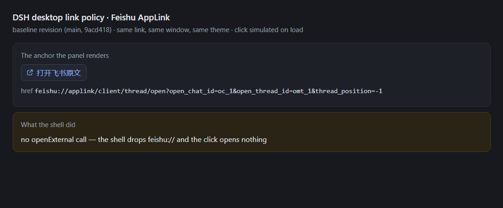
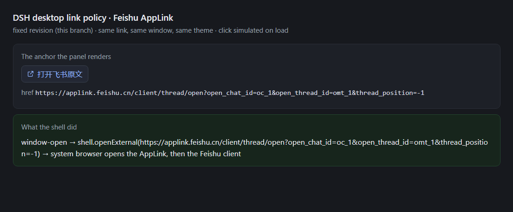

# 桌面 App 里 Feishu AppLink 点了没反应

## 现象

桌面 App（Electron 44.7.0 渲染 3082 的同一个面板）里点「打开飞书原文」、话题 chip、「去飞书回答」这类链接没有任何反应：
不打开浏览器，也不拉起飞书客户端。同一个面板在 Chrome 里正常（链接把 AppLink 交给已安装的飞书客户端）。

## 根因

面板的客户端把 `https://applink.feishu.cn/…`（Lark 为 `applink.larksuite.com`）统一转成客户端 scheme
`feishu://applink/…` / `lark://applink/…`，并故意不加 `target`（`src/client/widgets.tsx` 的 `clientHref`/`linkTarget`），
这样在浏览器里点一下就直接交给飞书客户端，不会先开一张 `https://applink…` 落地页标签。

桌面壳只认 http(s)：`apps/desktop/src/main.ts` 的 `setWindowOpenHandler` 只对 http/https 调 `shell.openExternal`，
`will-navigate` 对非 `dsh-app:`、非同源的地址一律 `preventDefault`，也只有 http(s) 才交给系统浏览器。
于是 `feishu://` 的点击被窗口丢掉：既不打开浏览器，也不会到操作系统去拉起客户端。

## 修复

`src/client/widgets.tsx`：页面在 Electron（桌面壳）里时保留 AppLink 的 `https://` 形式，并照常带
`target="_blank"`；窗口把 http(s) 交给系统浏览器，浏览器再按飞书的降级协议拉起客户端。浏览器里的行为不变
（仍是 `feishu://`、无 `target`，不留落地页）。旧工单里已经存成 `feishu://` 的链接在桌面壳里也还原成 https 形式。

## 证据

同一个链接、同一个窗口尺寸（900×430，深色）、同一个 Electron 版本（44.7.0，与 App 一致），
只切换渲染出的 anchor（基线 / 本分支）：

- 基线（main `9acd418`）：面板渲染 `feishu://applink/client/thread/open?…`，无 `target`；桌面壳收到
  `will-navigate feishu://…` 后 `preventDefault`，`shell.openExternal` 没有被调用 → 什么也不打开。
  
- 本分支：面板渲染 `https://applink.feishu.cn/client/thread/open?…` + `target="_blank"`；桌面壳收到
  `window-open https://applink…` 并调用 `shell.openExternal(https://applink…)` → 系统浏览器打开 AppLink，再拉起客户端。
  

- `anchor-before.html` / `anchor-after.html` 是两次渲染出的 anchor HTML；`anchor-browser.html` 是本分支在浏览器里
  的渲染，仍是 `feishu://` 无 `target`（浏览器行为没变）。
- 真实 App 里的基线现象：对运行中的 App 用 UI Automation 触发「打开飞书 原文」链接后，Chrome 标签数不变、
  没有新的飞书窗口（该链接的 href 就是 `feishu://applink/…`）。App 截图含内部工单标题，未放入本目录。

## 复现命令

```
electron.exe --no-sandbox evidence/app-external-links-24c2af152698/link-policy-fixture.cjs before before.png
electron.exe --no-sandbox evidence/app-external-links-24c2af152698/link-policy-fixture.cjs after after.png
```

`link-policy-fixture.cjs` 原样使用上面两条桌面壳规则（`apps/desktop/src/main.ts` 的 `createWindow()`），点击
渲染出的 anchor 并记录结果；它把 `shell.openExternal` 换成记录，不真的拉起浏览器或飞书客户端。

## 限制

桌面 App 里的端到端「修复后」截图需要把修复后的客户端部署到运行中的宿主（升级并重启宿主），本工单不做这一步：
它会中断正在跑的会话。等这次改动随正常更新进到 App 后，可在 App 里点同一个链接复验。
