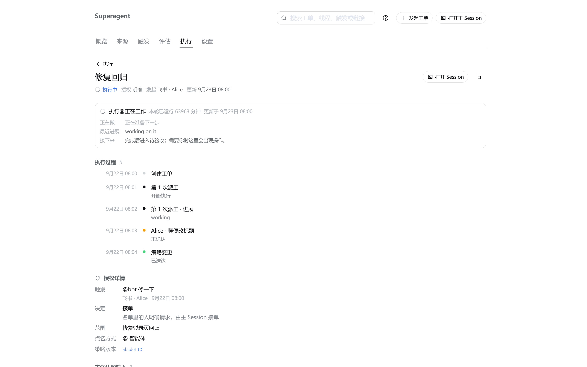
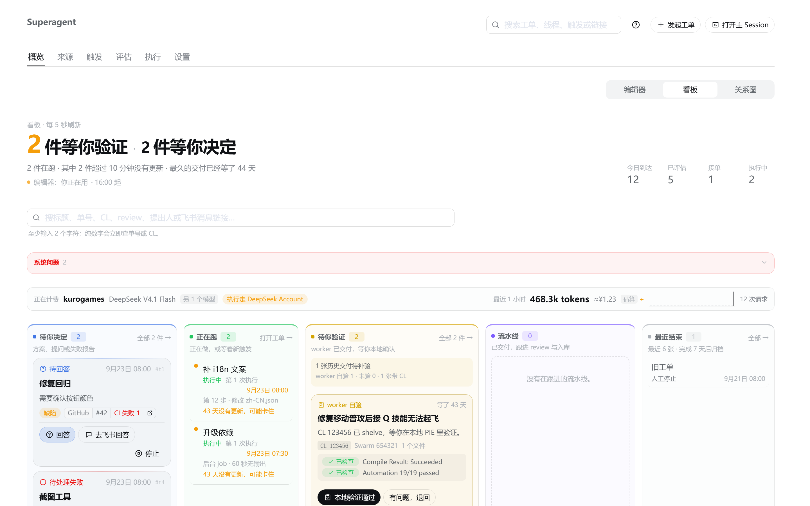
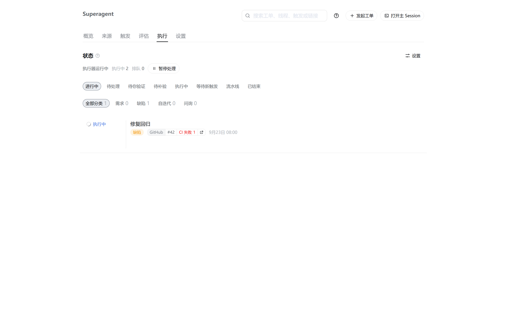

# Back from a Ticket opened without history: up to the Execution list

Reported on 2026-11-05: a Ticket opened from a Feishu `?ticket=` link leaves the panel at the home board when Back is
pressed, although the Ticket belongs to the Execution list, and the page's Back button says 概览. On a Mac trackpad the
browser's two-finger swipe is the same history step, so a page with no history behind it made the gesture leave DSH Web
instead of going up a level.

## Change

- Back falls back to the page's parent menu when the panel has no history to step: a Ticket goes to 执行, a Thread to
  触发 (`parentRoute` / `backRoute` in `src/client/route.ts`). The page Back button names that list.
- A record the panel opens without history behind it (a Feishu `?ticket=` link, a Session's 工单 jump) now writes its
  parent menu into the browser entry just behind the page and then pushes the page. The page Back button, a mouse's side
  buttons and the browser's Back/Forward — the entries the macOS two-finger swipe steps — all land on the parent list.
- A reload continues at the entry the browser is on, instead of reopening the `?ticket=` link the tab was opened with.
- Horizontal trackpad panning in the tab bar and the relation graph stays in its own list
  (`overscroll-behavior-x: contain`), as the board already did.

## Evidence

| | Before — `61e8445` (main at ticket start) | After — this branch |
| --- | --- | --- |
| A Ticket opened from `?ticket=` |  |  |
| After pressing that Back button |  |  |

The facts beside each image:

- before: the Ticket's Back label is `概览`, `history.length` is 1, and Back lands on the board (`board: true`,
  概览 selected).
- after: the Back label is `执行`, `history.length` is 2 (the parent entry is behind the page), and Back lands on the
  Execution list (`board: false`, 执行 selected) without adding an entry.

Method: the same scenario rendered from both revisions — the real panel `App` in a local harness page with the test
fixture's fake management API and the host's design-platform theme, 1440×900 CSS pixels at DPR 2, light theme, Chinese,
synthetic Ticket data (no Feishu content). Before is `61e8445`; after is this branch. The browser-history entries are
the panel's own real entries. The macOS trackpad's swipe is the same same-document history traversal that fires
`popstate`, exercised in `tests/panel-navigation.spec.tsx`; the gesture itself was not captured on Mac hardware, and the
harness is not the full DSH shell (the same scope as the earlier panel captures in #65).
