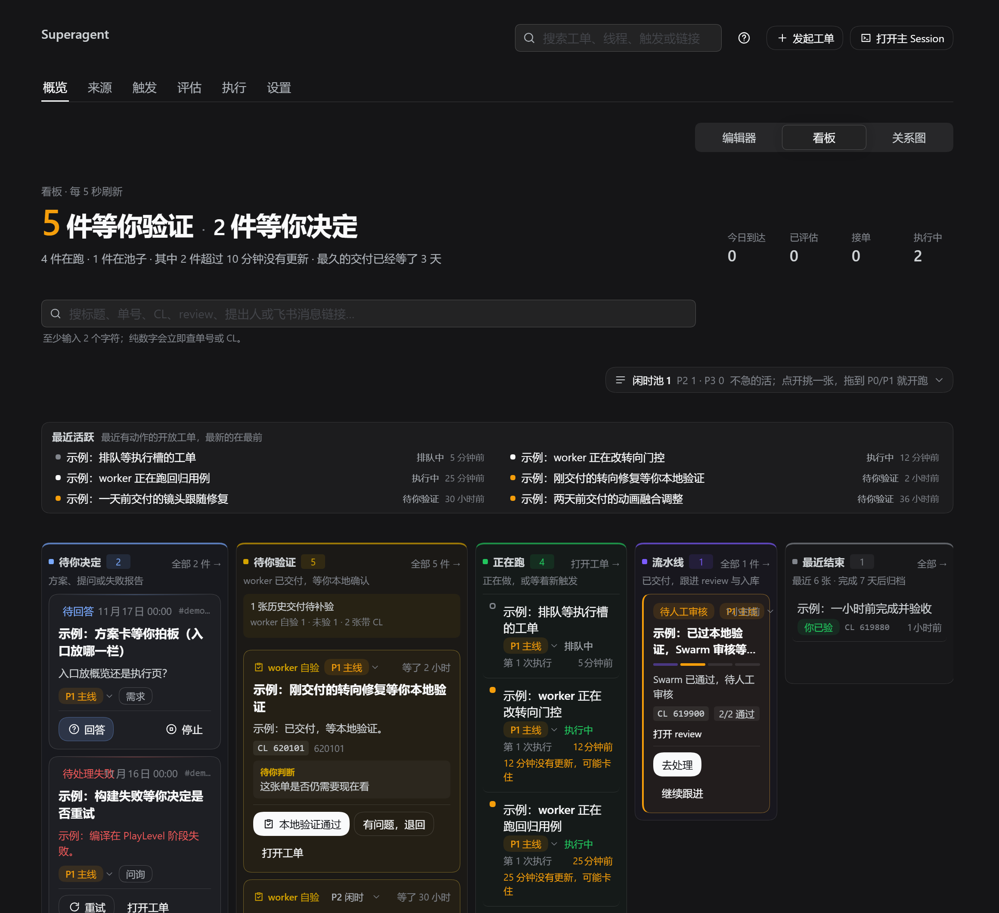
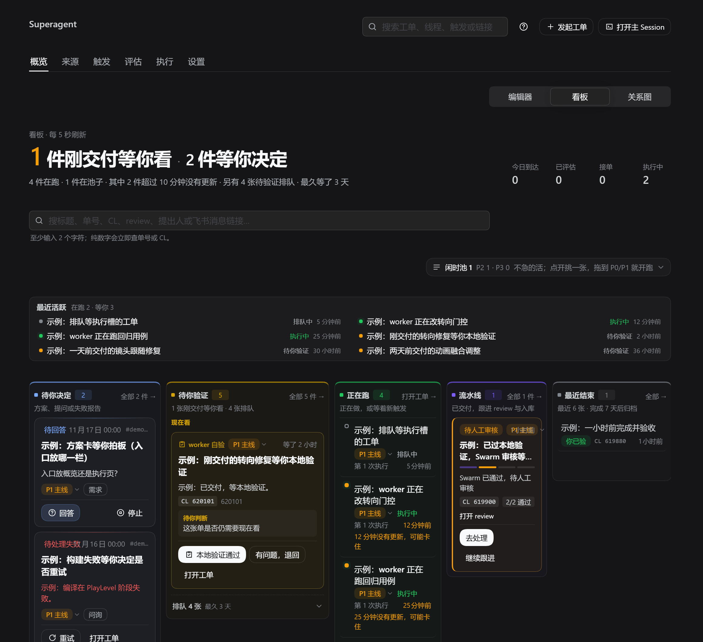
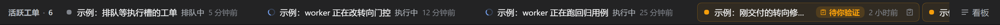
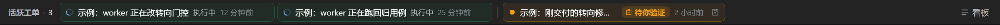

# Board hierarchy: live work first, and only the handovers that still ask

Reported in the retro topic on 2026-11-18: *"还有看板，待验证太多了，颜色样式也一样，我看不出来哪个是活跃的，现在全放底下标签栏的做法太粗暴"* —
and clarified one message later: *"不是弱化待验证 而是弱化不该占据注意力的待验证"*. The board led with a large number of
identically amber verification cards, the recently-active band and the always-visible bottom dock listed every recent
Ticket in one flat style, and nothing said which Ticket was actually moving.

## Change

- **`src/core/verification.ts`** — `verifyFocus(ticket, now)`: a pending local check asks for a person *now* when the
  Ticket is live and was handed over within the last day (`VERIFY_FOCUS_MS`), or when it is urgent (`P0`). An older live
  delivery, a pooled P2/P3 one, and an ended Ticket waiting for a backfill are the standing queue.
- **`src/app/views/overview.ts`** — the board answer gains `verifyNow` (the fresh/P0 handovers, newest first) and
  `verifyLater` (the queue, oldest first); `verification` keeps the lane's full order, now-first. No Ticket leaves the
  count or the lane's "全部" link.
- **`src/client/overview.tsx`** — the verdict counts only what needs a person now (`1 件刚交付等你看 · 2 件等你决定`) and
  states the queue as one clause (`另有 4 张待验证排队 · 最久等了 3 天`). The verify lane shows the fresh handover(s) as
  cards and folds the rest behind one `排队 N 张` line that names the longest wait and opens into compact rows. The
  recently-active band leads with `在跑 N · 等你 M` and marks a moving row with a breathing green dot and green stage;
  the running lane's dot breathes too, so live work reads without hovering.
- **`src/client/dock.tsx`** — the bottom strip keeps only rows that are active: live work first (spinner, green tint),
  then Tickets waiting on a person for something current (amber pill; a handover only while `verifyFocus` holds). A
  queued or idle turn and an older handover are not active and stay on the board; the dock hides when neither remains.
- `docs/005-panel.md` and `docs/007-architecture.md` state the split and the narrower dock. Tests pin the rule, the
  verdict, the folded queue, the band's live row and the dock's filtering.

## Before / After

| | Before — `origin/main` `a839871` | After — this branch |
| --- | --- | --- |
| Board |  |  |
| Bottom dock |  |  |

Both pairs come from the same synthetic fixture, viewport (**1440 × 1200 CSS px at DPR 2**), dark theme, board route and
frozen clock (`2026-11-18T16:00:00Z`); the only difference is the checkout that built the client bundle and rendered the
`GET overview` answer. The board image is the `.dt-page` content (1160 × 1060); the dock image is the frame-wide
`shell.bottom` strip (1440 × 37).

## Measurements

| | Before | After |
| --- | --- | --- |
| Verdict | `5 件等你验证 · 2 件等你决定` | `1 件刚交付等你看 · 2 件等你决定` |
| Verification lane | 5 equal amber cards (2 h, 30 h, 36 h, 3 d, ended) | 1 card + one folded `排队 4 张 · 最久 3 天` line |
| Queue visible without opening | one backlog strip, the rest as cards | count and longest wait on one line; rows one click away |
| Recently-active band | 6 flat rows; only the dot tone differs | `在跑 2 · 等你 3`; live rows green and breathing |
| Dock rows | 6 — queued turn, 2 live, 3 handovers (1 fresh, 2 older) | 3 — 2 live, separator, 1 fresh handover |
| Dock hidden rows | — | the queued turn and the two day-old handovers |

## Method

`fixture.db` is a synthetic database (no real Ticket text): two decisions, one fresh handover, two live deliveries older
than a day, one ended backfill, two running turns, one queued turn, one waiting Ticket, one blocked pipeline, one pooled
P2 and one ended change. `capture/seed.ts` creates it with pinned timestamps; `capture/views.ts` renders each checkout's
own `GET overview` answer over it; `capture/shoot.mjs` loads the live panel, replaces the `dsh-superagent` client module in
the served bundle with that checkout's built `lib/client.js`, answers `GET overview` from the rendered JSON, freezes
`Date.now`, and captures the board and the bottom strip.

```sh
# from the repository root, with the ticket's node_modules installed
git worktree add ../before origin/main && (cd ../before && pnpm install --frozen-lockfile && pnpm build)
pnpm build
node --experimental-transform-types evidence/board-active-clarity-03c3c81c3852/capture/seed.ts . evidence/board-active-clarity-03c3c81c3852/fixture.db 2026-11-18T16:00:00.000Z
node --experimental-transform-types evidence/board-active-clarity-03c3c81c3852/capture/views.ts .. evidence/board-active-clarity-03c3c81c3852/fixture.db evidence/board-active-clarity-03c3c81c3852/capture/before-views.json
node --experimental-transform-types evidence/board-active-clarity-03c3c81c3852/capture/views.ts . evidence/board-active-clarity-03c3c81c3852/fixture.db evidence/board-active-clarity-03c3c81c3852/capture/after-views.json
FREEZE_NOW=1795017600000 node evidence/board-active-clarity-03c3c81c3852/capture/shoot.mjs \
  evidence/board-active-clarity-03c3c81c3852/capture/before-views.json ../before/lib/client.js "$PANEL_URL" \
  evidence/board-active-clarity-03c3c81c3852/before-board.png evidence/board-active-clarity-03c3c81c3852/before-dock.png
FREEZE_NOW=1795017600000 node evidence/board-active-clarity-03c3c81c3852/capture/shoot.mjs \
  evidence/board-active-clarity-03c3c81c3852/capture/after-views.json lib/client.js "$PANEL_URL" \
  evidence/board-active-clarity-03c3c81c3852/after-board.png evidence/board-active-clarity-03c3c81c3852/after-dock.png
```

## Limit

The fixture is synthetic, so the images show the change on the reported shape rather than replaying the live board's
exact mix, and the counts (4 running, 1 in the pool) are the fixture's, not production's. The live panel shell and its
theme are real; the host's own `GET overview` is replaced by each checkout's rendered answer, and the ticket text was
written for this capture. The before bundle is `origin/main` `a839871`, the branch point; the after bundle and views come
from this branch. The panel URL's token authenticates the page and is never written to a file.
