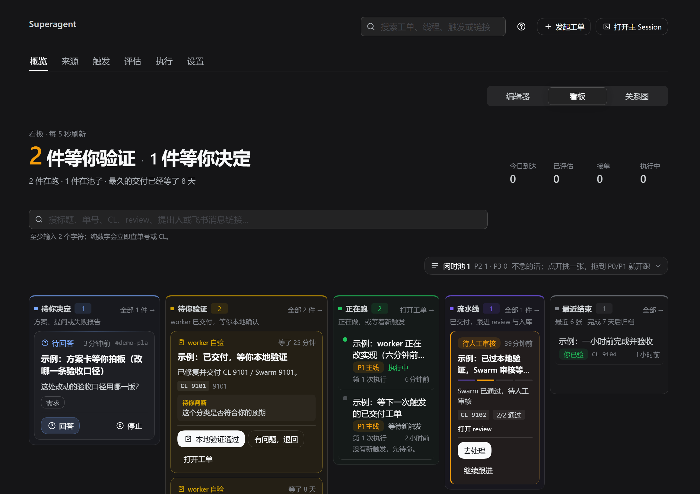
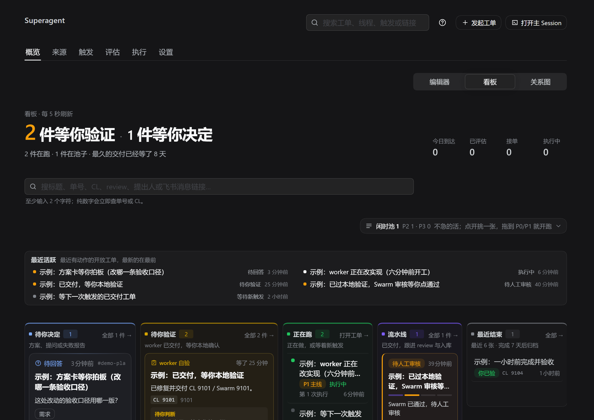

# Board: the recently active Tickets lead the lanes

Reported on 2026-11-16 in the retro topic: *"ready 很多，落地很少 … 要做个分类 让我最近正在蹬的活跃单能被一眼看出 在最容易触达的位置 排序 分类操作一下就行 不用大改活跃显示"* —
with many Tickets waiting for a local check, the work the person had been driving lately was spread across the five
lanes and the board gave no one place to find it.

## Change

- **`src/core/activity.ts`** — `lastActivityAt(ticket)`: the newest real event on a Ticket (an Input, a worker turn or
  Report, the plan, verification and delivery facts, a confirmation, a priority a person set, a back-move or a repair).
  It deliberately ignores `updatedAt` and the pipeline observation time: the pipeline watcher saves the Ticket on every
  poll and rewrites `updatedAt` even when nothing a person can see changed, so a Ticket would otherwise rank by the
  host's heartbeat rather than by what happened on it.
- **`src/app/views/overview.ts`** — the board's answer gains `active`: up to six open Tickets whose newest real event is
  in the last seven days, newest first. Discretionary P2/P3 work waiting for an idle window stays behind the pool dock and
  out of the band; a Ticket with no event at all does not appear. The lanes and their own ordering are unchanged.
- **`src/client/overview.tsx`** — a compact **最近活跃** band directly above the five lanes lists those Tickets with their
  fine stage (`待回答`, `待你验证`, `执行中`, …) and how long ago the event was; a row opens the Ticket. It is a shortcut
  into the lanes, not a sixth lane, and it renders nothing when no open Ticket has recent activity.
- `docs/005-panel.md` and `docs/007-architecture.md` state the band and the new module. Tests pin the ordering, the
  six-row limit, the seven-day window, the pool exclusion, the hidden band and the click-through.

## Before / After

| | Before — `origin/main` `c89e88d` | After — this branch |
| --- | --- | --- |
| Board |  |  |

The same fixture, viewport (1160 × 820 CSS px at DPR 2), dark theme and board route in both images. The only difference
between the two runs is the checkout that built the panel client and rendered the board answer; the page's clock is
frozen at the fixture time so both show the same ages.

## Measurements

| | Before | After |
| --- | --- | --- |
| Band above the lanes | — | 5 rows: `待回答 3 分钟前`, `执行中 6 分钟前`, `待你验证 25 分钟前`, `待人工审核 40 分钟前`, `等待新触发 2 小时前` |
| Lane counts (`待你决定` / `待你验证` / `正在跑` / `流水线` / `最近结束`) | 1 / 2 / 2 / 1 / 1 | 1 / 2 / 2 / 1 / 1 |
| Pooled P2 in the band | — | excluded (stays behind `闲时池 1`) |
| Eight-day-old delivery in the band | — | excluded by the seven-day window (still in `待你验证`) |

## Method

`fixture.db` is a synthetic database (no real Ticket text): one Ticket in each lane with its newest real event 3
minutes, 6 minutes, 25 minutes, 40 minutes, 2 hours and 8 days old, plus a pooled P2. `capture/seed.ts` creates it;
`capture/views.ts` renders the panel's own `GET overview` answer from a checkout over that database; `capture/shoot.mjs`
loads the live panel, replaces the `dsh-superagent` client module in the served bundle with that checkout's built
`lib/client.js`, answers `GET overview` from the rendered JSON, and captures the `.dt-page` content in headless Chrome.
The app shell, theme, layout and every other route are the deployed ones; the session sidebar is cropped out.

```sh
# from the repository root, with the ticket's node_modules installed
git worktree add ../before origin/main
# build each checkout (tsdown), then:
node --experimental-transform-types evidence/board-active-sort-0d9f78019c7a/capture/seed.ts . evidence/board-active-sort-0d9f78019c7a/fixture.db 2026-11-16T18:45:00.000Z
node --experimental-transform-types evidence/board-active-sort-0d9f78019c7a/capture/views.ts . evidence/board-active-sort-0d9f78019c7a/fixture.db evidence/board-active-sort-0d9f78019c7a/capture/after-views.json
node --experimental-transform-types evidence/board-active-sort-0d9f78019c7a/capture/views.ts ../before evidence/board-active-sort-0d9f78019c7a/fixture.db evidence/board-active-sort-0d9f78019c7a/capture/before-views.json
FREEZE_NOW=1794854700000 CLIP_HEIGHT=820 PANEL_URL=<operator panel URL> node evidence/board-active-sort-0d9f78019c7a/capture/shoot.mjs \
  evidence/board-active-sort-0d9f78019c7a/capture/before-views.json ../before/lib/client.js "$PANEL_URL" evidence/board-active-sort-0d9f78019c7a/before-board.png
FREEZE_NOW=1794854700000 CLIP_HEIGHT=820 PANEL_URL=<operator panel URL> node evidence/board-active-sort-0d9f78019c7a/capture/shoot.mjs \
  evidence/board-active-sort-0d9f78019c7a/capture/after-views.json lib/client.js "$PANEL_URL" evidence/board-active-sort-0d9f78019c7a/after-board.png .dt-active
```

## Limit

The fixture is synthetic, so the images show the change on the recorded shape rather than replaying the live board's
exact Ticket mix. The captures were taken minutes apart against the live panel shell with the page clock frozen; the
live host's other endpoints (state, billing) are not part of the comparison. The `before` client was built from
`origin/main` `c89e88d`, the branch point of this change.
