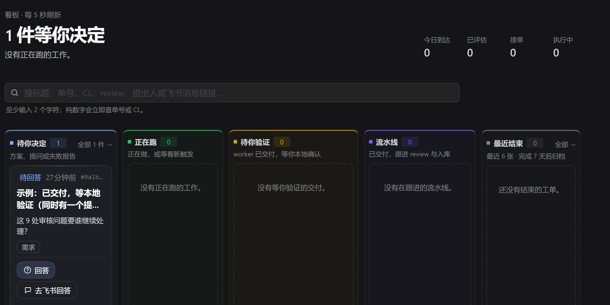
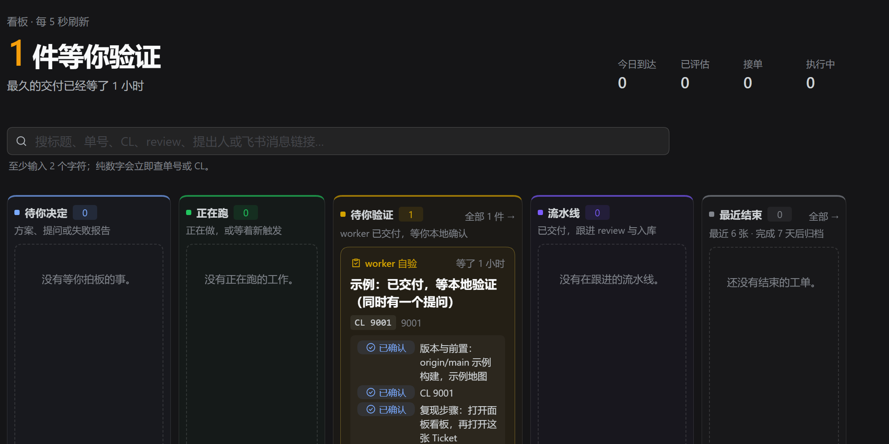
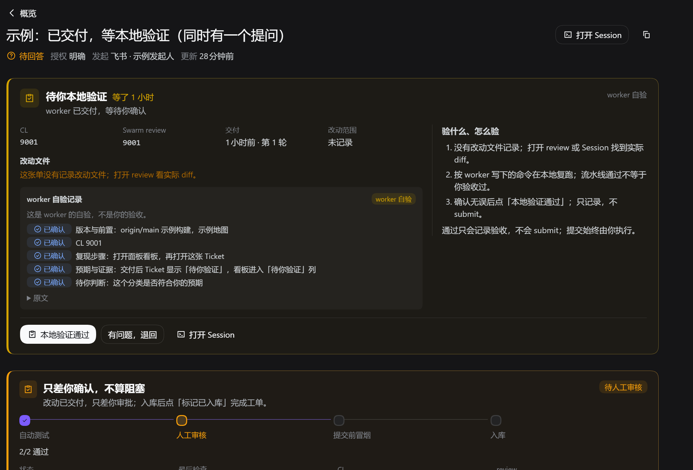

# Board classification: the local-verification gate before a question and the pipeline

Reported on 2026-11-05: a Ticket whose worker had delivered a changelist and review showed **待回答** in its status line
and sat in the **待你决定** lane, while the page itself led with the **待你本地验证** gate. The board's **待你验证** lane was
empty although delivered work was waiting for the person's local check.

## Cause

`ticketStage()` in `src/core/stage.ts` is the single classification the board lanes, the ticket status line, the lists,
the Feishu cards and `waitingOf()` all read. The table in `docs/003-execution.md` is read top to bottom, first match wins.

Commit `d7561b9` (the host-side pipeline follow-up) moved the local check below both an open question and the pipeline
stage. Its reason — the host now follows the pipeline from delivery, so the person's verification no longer starts it —
holds for the follow-up itself, but it also meant a delivered Ticket that waits for the person's mandatory P4.5 check was
classified as `person/answer` (or `pipeline/...`) and never reached the `person/verify` stage. That contradicted the
Ticket page's own order, which renders the verification gate first, then the pipeline gate, then the question.

The same shape was live at report time: two delivered Tickets with `verification: pending` and an open question sat in
**待你决定** while **待你验证** had nothing.

## Change

The local check now comes before an open question and the pipeline stage (after an undelivered Input and an ended
Ticket). The host still follows the pipeline in parallel from delivery; once the local check passes, the Ticket reports
`pipeline / running` or `pipeline / blocked` as before. `docs/003-execution.md` and `docs/012-gates-and-cards.md` state
that order; `tests/stage.spec.ts`, `tests/views.spec.ts` and `tests/core-engine.spec.ts` pin it.

## Evidence

| | Before — `origin/main` `eb16346` | After — this branch |
| --- | --- | --- |
| Board |  |  |
| Ticket page |  |  |

Method: `fixture.db` is a small synthetic database (no real Ticket text) holding the reported shape — a Ticket that
delivered CL 9001 / review 9001, has `verification: pending`, one open question and one blocked pipeline. `capture/seed.ts`
creates it; `capture/views.ts` renders the panel's own server views (`GET overview`, `GET tickets`,
`GET tickets/:id`) over it; `capture/shoot.mjs` serves one build's views into the same live panel client and captures the
board and the Ticket page in headless Chrome. The before views were rendered from a clean `origin/main` checkout and the
after views from this branch; the client bundle is the deployed one, because this change is server-side. Images are
cropped to the panel content: the session sidebar is the operator's own, not part of this evidence.

```sh
# from the repository root; the last command also needs the operator's authenticated panel URL
node --experimental-transform-types evidence/board-classification-audit-0aca580d3313/capture/seed.ts . /tmp/fixture.db
node --experimental-transform-types evidence/board-classification-audit-0aca580d3313/capture/views.ts . /tmp/fixture.db 9a1b2c3d4e5f60718293a4b5c6d7e8f9 after-views.json
node evidence/board-classification-audit-0aca580d3313/capture/shoot.mjs after-views.json "$PANEL_URL" after 9a1b2c3d4e5f60718293a4b5c6d7e8f9
# before: the same commands with a checkout of origin/main as views.ts's first argument
```

Limitation: the fixture is synthetic. The reported live Ticket had already moved on (the person passed the local check
while the report was being read), so no capture replays the exact live Ticket; the screenshots show the classification
change on the same recorded shape. The sidebar was cropped out of the committed images.
