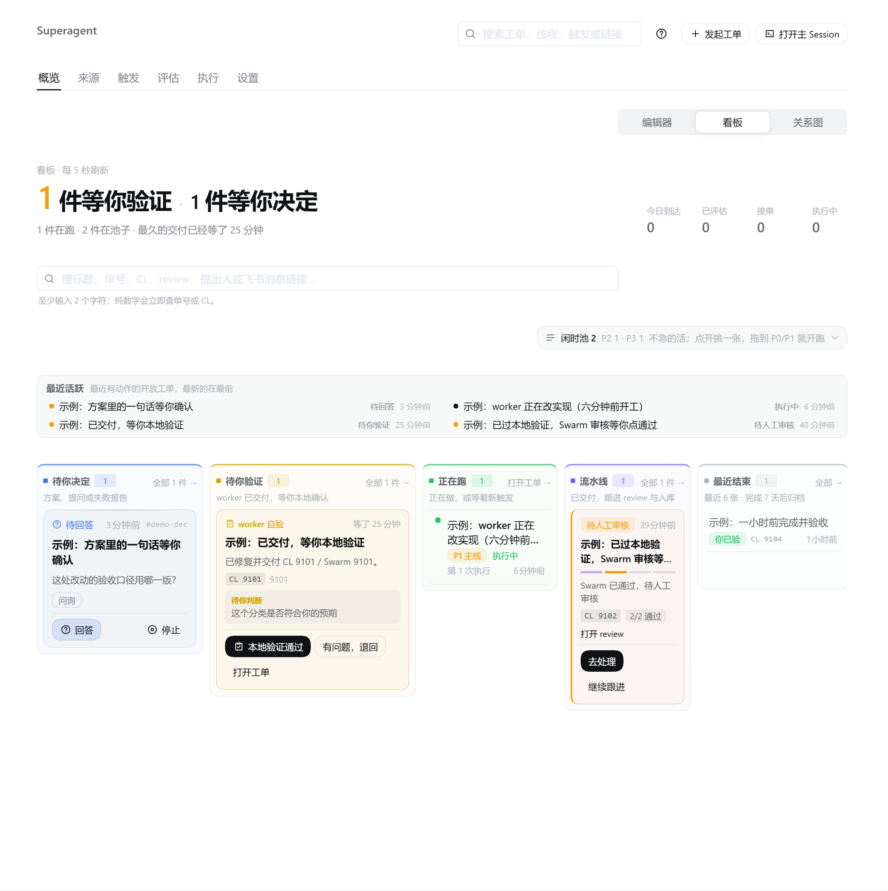
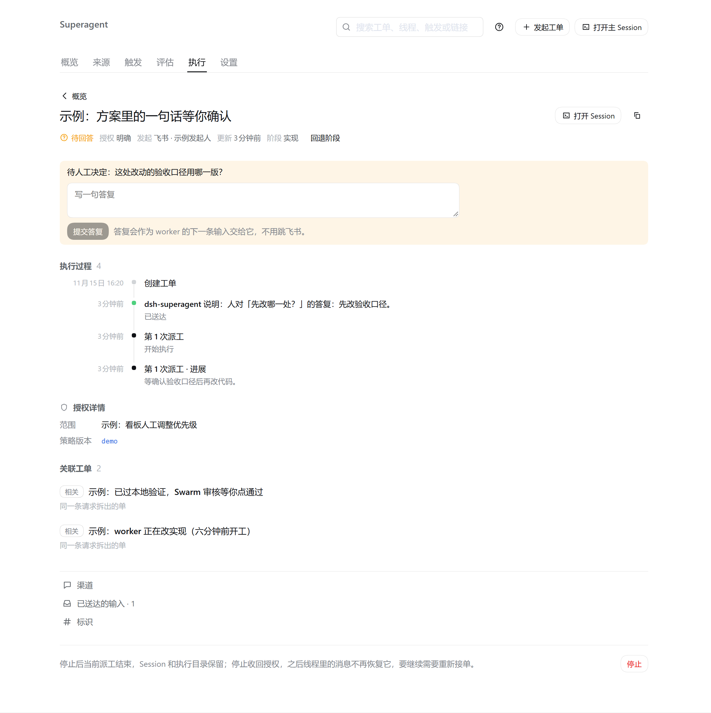
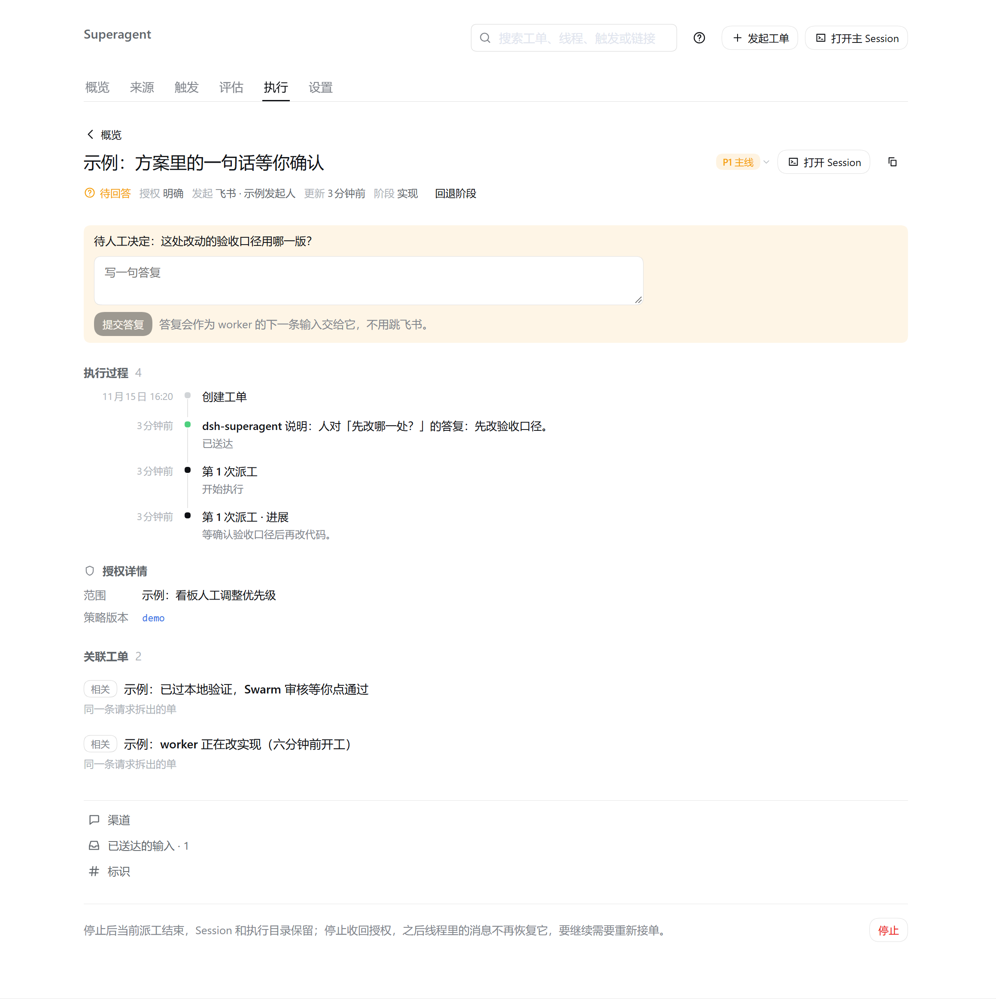
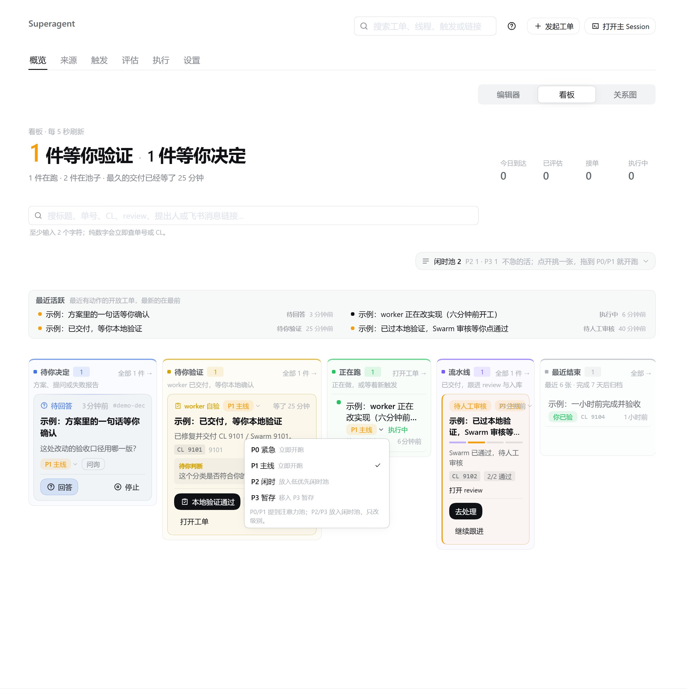
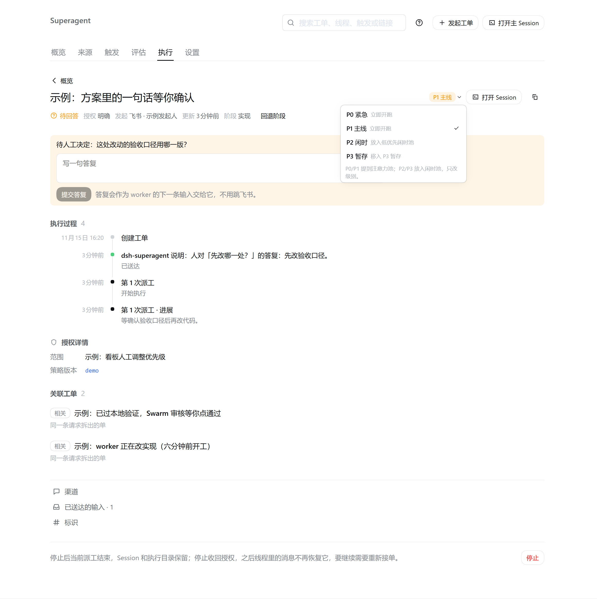

# 看板：在任何开放工单上人工调整优先级（含放入低优先闲时池）

2026-11-17，看板操作人报：*「这个单子可以放进低优先闲时池 我在看板上没地方操作 分别处理/提单」*，随后补充
*「不只是放入低优先 而是要能在工单上人工调整优先级」*。

改动前，优先级只能从闲时池抽屉里改：`待你决定`、`待你验证`、`正在跑`、`流水线` 四列里的开放工单没有入口，
一张正在跑或等人的 P1 想降为 P2 必须先在别处找到它；工单页也没有这个入口。

## Change

- **`src/client/priority.tsx`** — 新增共享的 `PriorityMenu`：标签（闲时池行是设置图标）是触发点，弹层里是同一组
  四档动作；P0/P1 走 `promote`（提到注意力池，必要时起一轮），P2/P3 走 `priority`（只改级别，不开跑）。
  弹层 portal 到页面，避免被卡片 `overflow` 或抽屉滚动裁掉；点外部/Esc/页面滚动会收起。
- **`src/client/overview.tsx`** — 决策卡的事实行、验证卡与流水线卡的头部、跑动行都挂这个入口；闲时池行改用同一个
  菜单（拖拽行为不变）。
- **`src/client/ticket.tsx`** — 开放工单的标题栏也挂同一个入口，改的是这张单自己的级别。
- **`src/client/locales.ts`, `client.css`** — 新文案与样式；P2 的说明就是「放入低优先闲时池」。
- **`docs/005-panel.md`, `docs/007-architecture.md`, `docs/019-priority-and-idle.md`** — 记录入口的范围与边界。
- **测试** — `tests/panel-overview.spec.tsx` 钉住跑动行/决策卡两个入口和 P0/P1→promote、P2/P3→priority 的路由；
  `tests/panel-execution.spec.tsx` 钉住工单页入口；抽屉原有菜单用例改用同一套弹层。

## Before / After

| | Before — `origin/main` `7838bea`（线上安装的构建） | After — 本分支 |
| --- | --- | --- |
| 看板 |  |  |
| 工单页 |  |  |
| 看板菜单（仅 After 有） | — |  |
| 工单页菜单（仅 After 有） | — |  |

同一份合成 fixture、同一个 1440 × 1200 CSS px（DPR 2）视口、浅色主题、看板路由；两边的页面时钟都冻结在
`2026-11-17T08:20:00Z`，所以「3 分钟前」「25 分钟前」一致。两边只有加载的 `dsh-superagent` 客户端构建不同：
Before 用线上安装的 `7838bea` 构建，After 用本分支 `pnpm build` 的 `lib/client.js`。这次改动不含服务端视图，
所以两边都从同一份 fixture 渲染 `GET overview` 与 `GET tickets/demo-decision-01`。

| | Before | After |
| --- | --- | --- |
| 待你决定卡片 | 无级别入口 | `P1 主线 ▾` |
| 待你验证卡片 | 无级别入口 | `P1 主线 ▾` |
| 正在跑行 | `P1 主线`（静态标签） | `P1 主线 ▾`，点开可取 P2「放入低优先闲时池」 |
| 流水线卡片 | 无级别入口 | `P1 主线 ▾` |
| 工单页标题栏 | 无级别入口 | `P1 主线 ▾` |
| 闲时池抽屉 | 行内设置图标 | 同一个设置图标，换用共享菜单（行为不变） |

## Method

`evidence/board-idle-pool-action-04a2566e4a06/fixture.db` 是合成数据库（没有任何真实工单文本）：四列各一张
开放 P1（一个问题、一个跑动中的 worker、一份待本地验证的交付、一条阻塞的流水线），再加 P2/P3 各一张和一张
已结束的单。`capture/seed.ts` 生成它；`capture/views.ts` 用本仓库自己的视图代码渲染 `GET overview` 和
`GET tickets/demo-decision-01`；`capture/shoot.mjs` 打开线上面板，用一份构建的 `lib/client.js` 替换页面里的
`dsh-superagent` 客户端模块，用 fixture 应答这两个接口，冻结页面时钟，然后在无头 Chrome 里截 `.dt-page`。

```sh
# 仓库根目录，先装依赖
node --experimental-transform-types evidence/board-idle-pool-action-04a2566e4a06/capture/seed.ts . \
  evidence/board-idle-pool-action-04a2566e4a06/fixture.db 2026-11-17T08:20:00.000Z
node --experimental-transform-types evidence/board-idle-pool-action-04a2566e4a06/capture/views.ts . \
  evidence/board-idle-pool-action-04a2566e4a06/fixture.db evidence/board-idle-pool-action-04a2566e4a06/capture/after-views.json
# $CLIENT_BEFORE = 线上安装的 dsh-superagent/lib/client.js（7838bea）
FREEZE_NOW=1794903600000 CLIP_HEIGHT=1200 node evidence/board-idle-pool-action-04a2566e4a06/capture/shoot.mjs \
  before evidence/board-idle-pool-action-04a2566e4a06/capture/after-views.json "$CLIENT_BEFORE" "$PANEL_URL" \
  evidence/board-idle-pool-action-04a2566e4a06
FREEZE_NOW=1794903600000 CLIP_HEIGHT=1200 node evidence/board-idle-pool-action-04a2566e4a06/capture/shoot.mjs \
  after evidence/board-idle-pool-action-04a2566e4a06/capture/after-views.json lib/client.js "$PANEL_URL" \
  evidence/board-idle-pool-action-04a2566e4a06
```

`$PANEL_URL` 是操作人自己已认证的面板地址（token 只经环境变量传入，不写进仓库）。

## Limit

fixture 是合成的，所以图里是这次改动的录制形态，不是线上真实工单组合的回放；截图取自线上面板壳，页面的
其他接口仍走线上宿主。Before 构建里没有这个控件，菜单打不开，所以两张菜单图是 After 的交互状态，不做
Before 对照。会话侧栏不属于本次页面，已裁掉；图中没有真实飞书内容。
