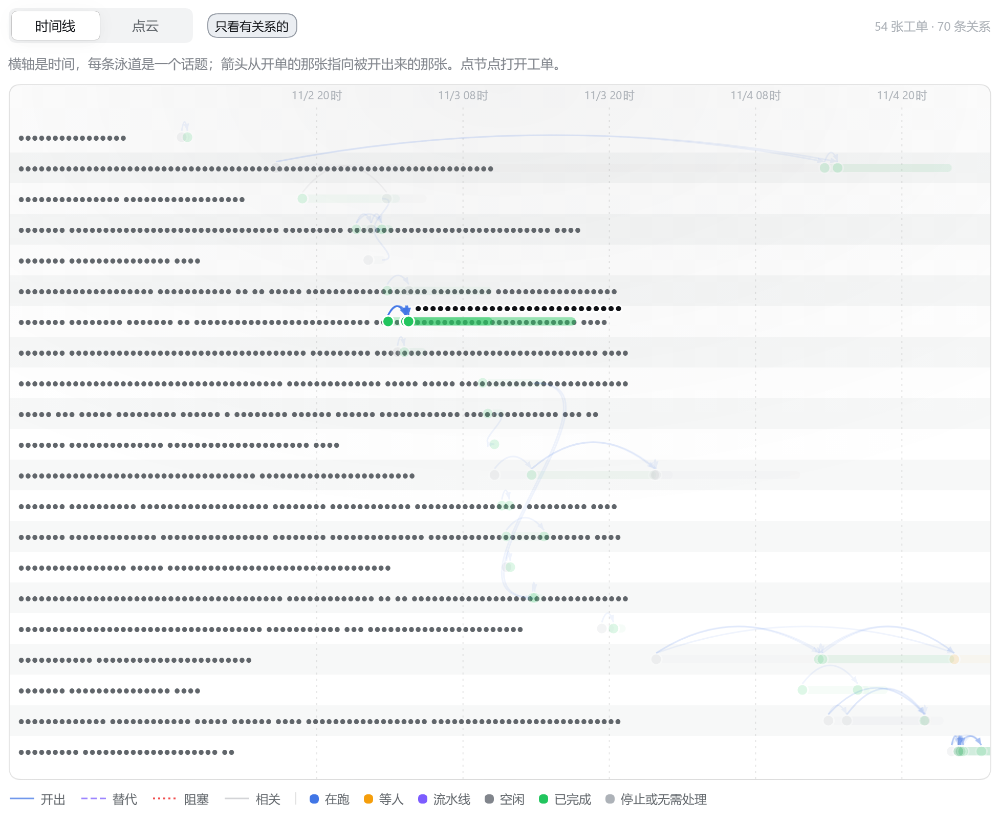
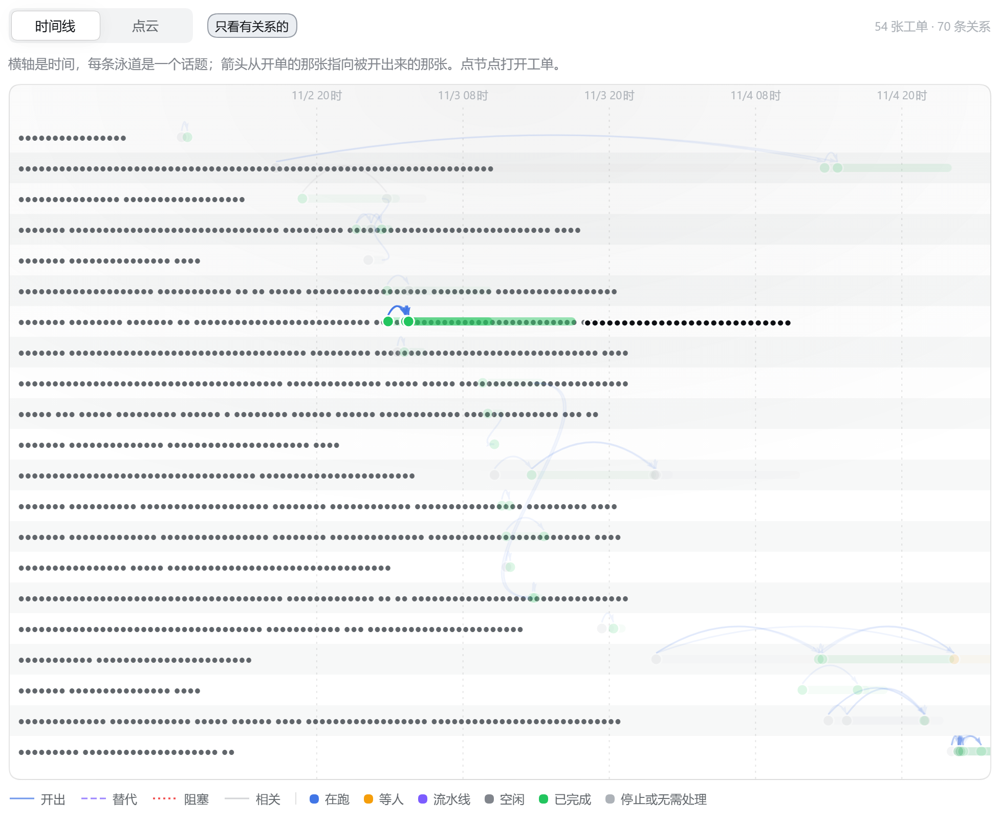
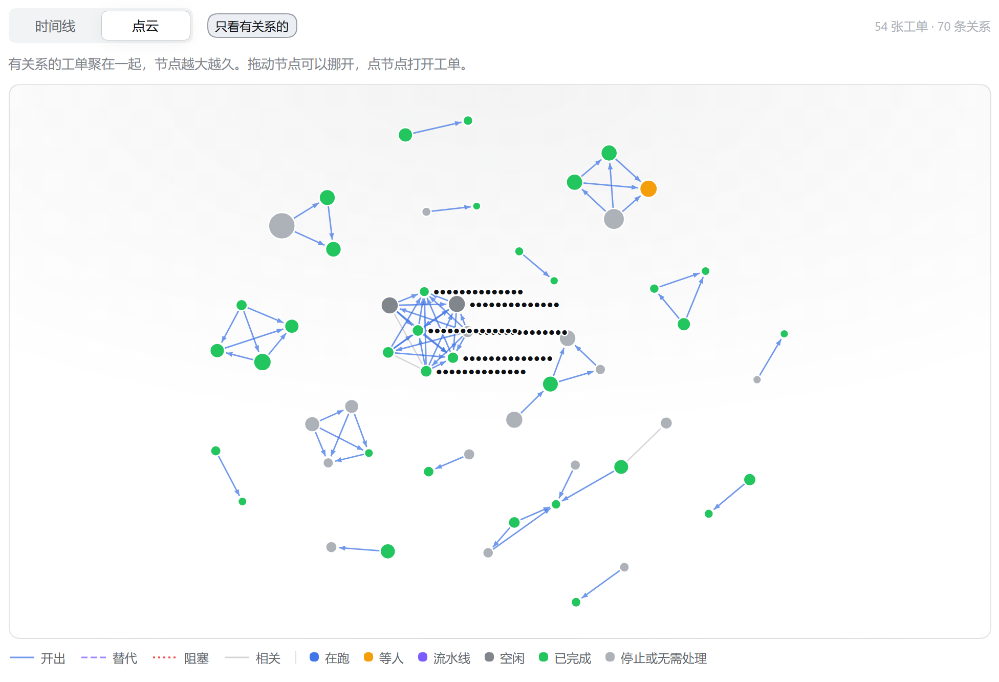
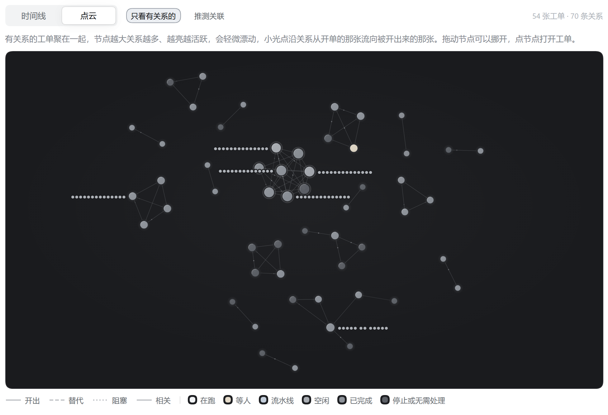
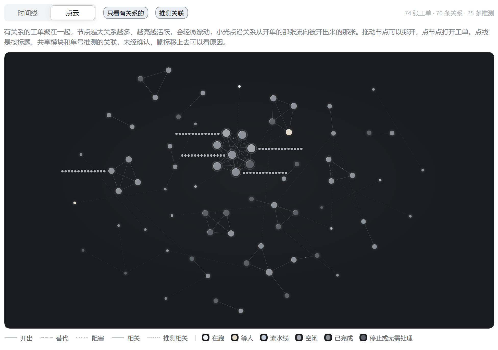
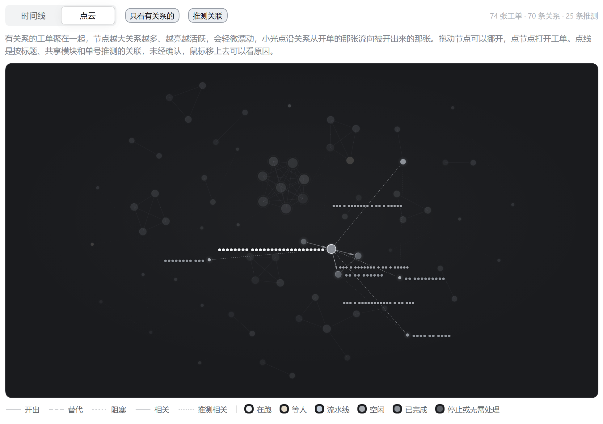
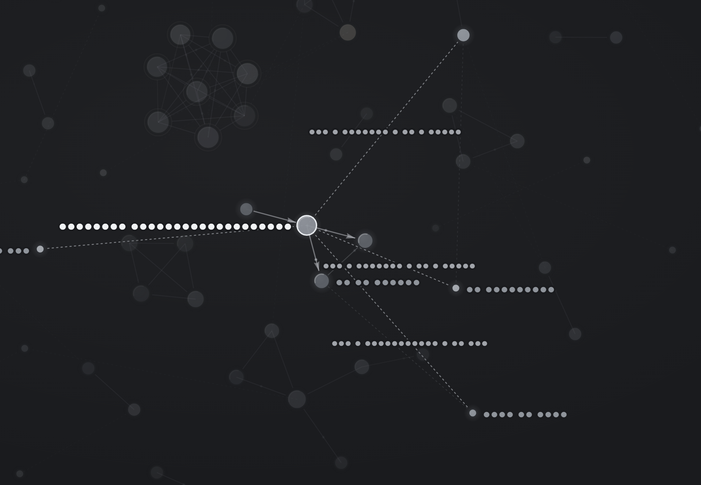

# Relation graph: silver cloud, motion, and guessed relations

Captured from the live Superagent panel (`http://127.0.0.1:3082`, 概览 → 关系图) on 2026-11-05 at 13:33–13:34 +08:00,
headless Chrome (`--headless=new`), viewport 1440 × 1000 CSS px at DPR 2, light theme, clipped to the graph section.
Every Ticket title, lane name and guessed-reason text is replaced with `●` before the shot, so no Feishu content appears.

- **Before** — the deployed `dsh-superagent` client bundle (main, SHA-256 `B3A16250…`), including the old cloud and the
  old filled arrowheads.
- **After** — this branch's built `lib/client.js` (SHA-256 `B712C333…`), spliced into the served plugin batch through CDP
  `Fetch`; every other request went to the live host.
- The live host still runs the deployed server, which does not compute the guessed `similar` edges. For the after shots
  that show them, `GET tickets/graph` was answered with the live response plus the 25 edges produced by
  `preview/fuzzy/analysis.py` against a read-only snapshot of the live database (133 Tickets, 73 explicit edges,
  threshold 0.30, top-3 per Ticket, capped at the explicit edge count). The server-side implementation in
  `src/app/views/similar.ts` is covered by `tests/similar.spec.ts` and the `ticketGraph` test.

| | Image |
| --- | --- |
| Before: 时间线, hover title above the span start |  |
| After: 时间线, hover title beside the node, vertically centred (same clip) |  |
| Before: 点云 (old light force layout) |  |
| After: 点云, silver cloud, guessed edges off (same clip) |  |
| After: 点云, guessed edges on — 74 Tickets, 70 relations, 25 guessed |  |
| After: 点云, hovering a hub: small filled arrowheads on its real relations, guessed edges lit as dotted lines |  |
| After: the same hover, 2x |  |

The masked `●` runs are Ticket names and guessed reasons; the reasons are only legible in the running panel (or through
the edge tooltips), never in this evidence. Captured metadata: `capture.json`.
