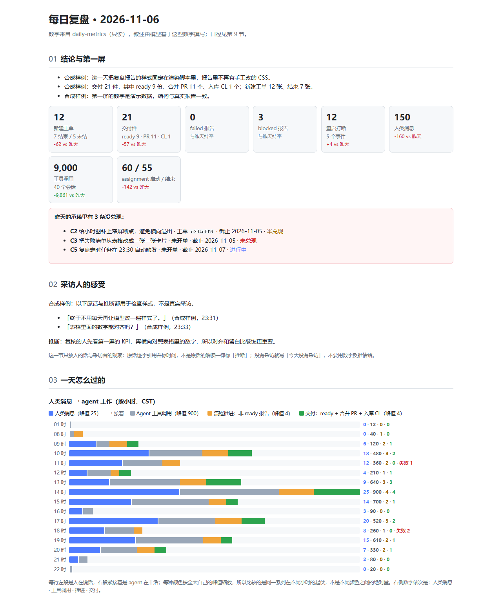
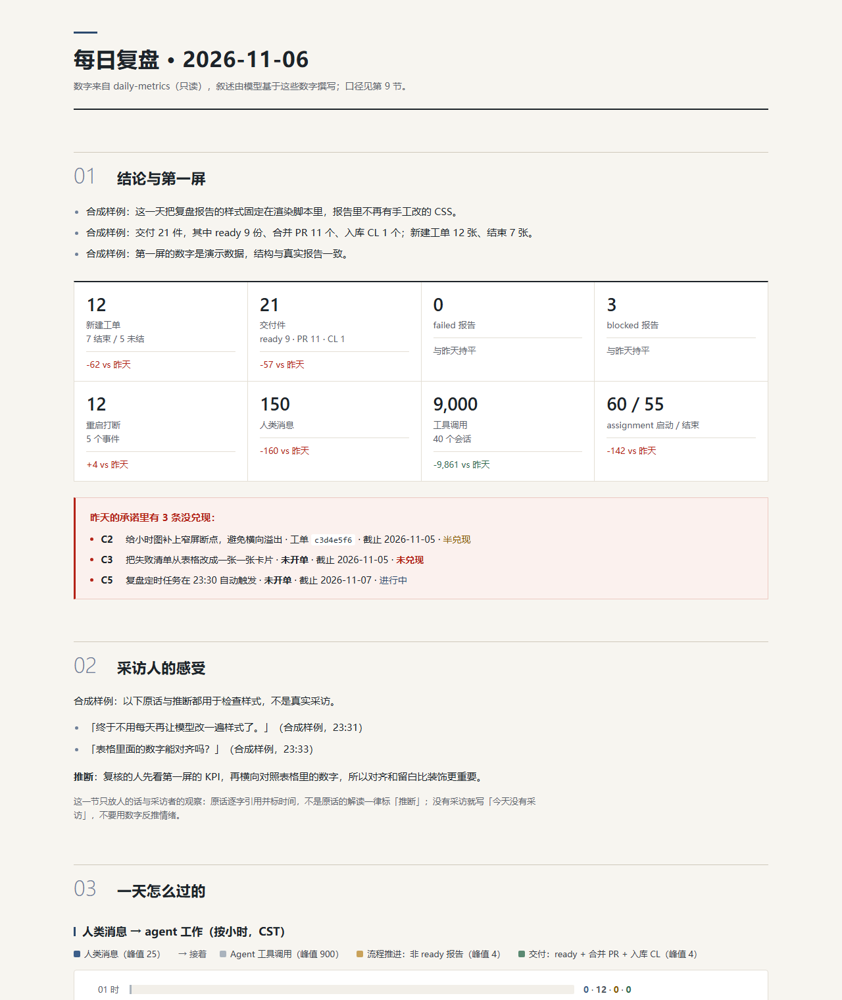
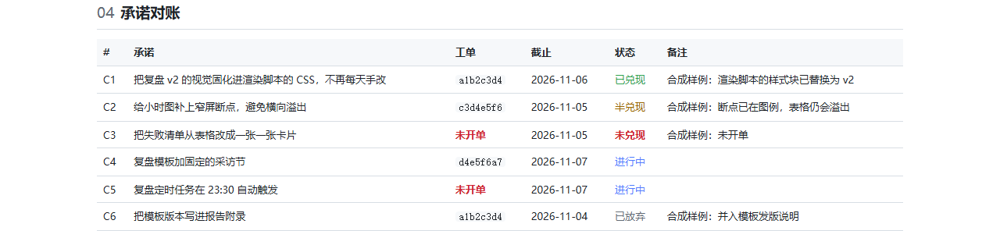
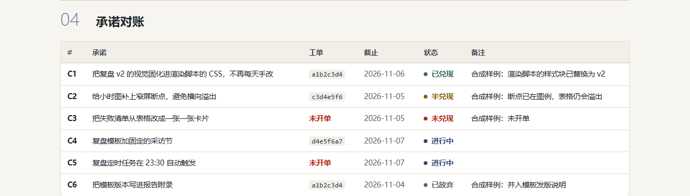
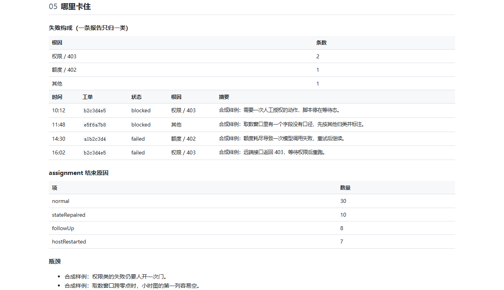
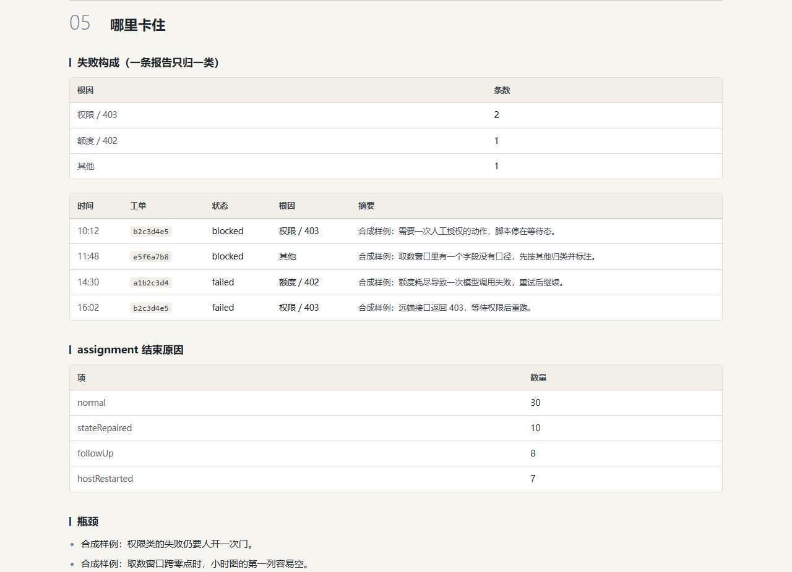
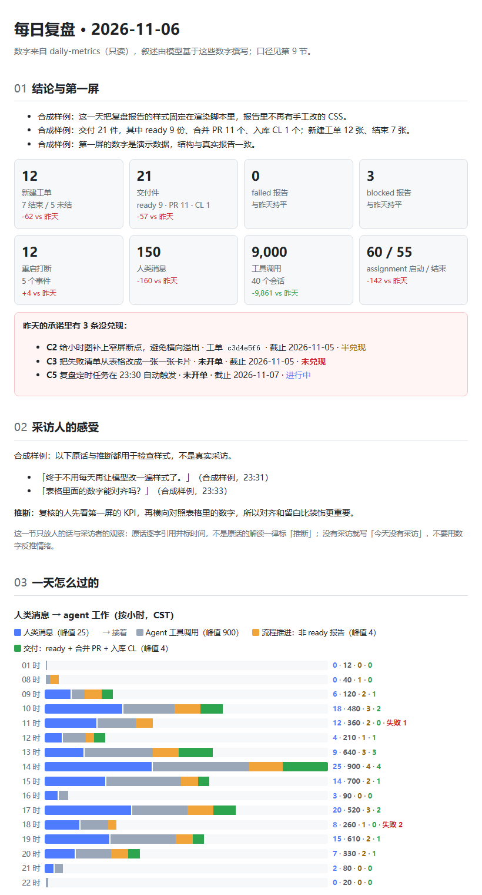
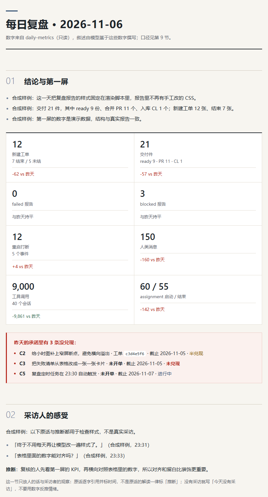
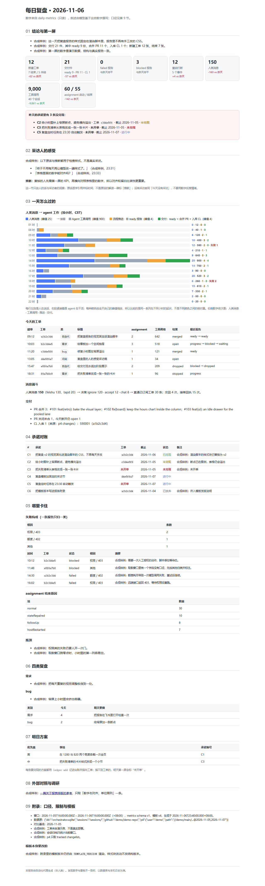
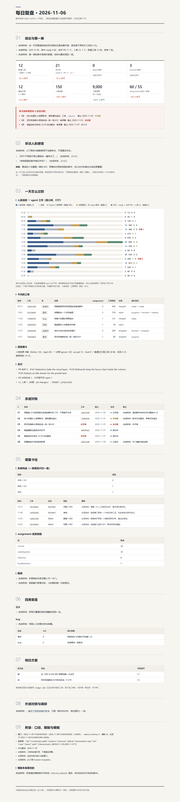

# Bake the 2026-11-06 retro v2 visual into the report CSS

The daily retro is rendered by `scripts/daily-retro.mjs render`. Its `<style>` block shipped a plain white,
blue-accented document, so after the 2026-11-06 retro the generated report was re-styled by hand into the v2 visual
(off-white paper, 黛蓝 accents, KPI cells separated by hairlines), and the next day's render started from the old CSS
again. This change moves that style block into the renderer so a report is generated in the v2 visual (commitment C34).

## Change

- `scripts/daily-retro.mjs`: the `CSS` template literal now holds the v2 style block verbatim — 7,859 characters:
  palette custom properties (`--paper #f7f5f0`, `--accent #2c4a6e`, …), the 4-column KPI panel with hairline gaps,
  section/header rules, table and status styling, the hour chart, the footer, and the 820px and print media queries.
- No markup, data or narrative change: for the same inputs the rendered body is byte-identical to the baseline body, so
  the whole diff is the style block plus a comment naming the visual baseline.

## Evidence

Same synthetic fixture (`fixture/`), baseline `origin/main` script on the left, this branch on the right.
Headless Chrome 1280×1000 CSS px (the 820 pair at 820×1000), DPR 1, light theme, zh-CN.

| | Before — `origin/main` | After — this branch |
| --- | --- | --- |
| First screen: header, KPI panel, first-screen alert |  |  |
| 04 承诺对账: table, code spans, status dots |  |  |
| 05 哪里卡住: counter tables, failure list, markdown |  |  |
| 820 px: the KPI panel folds to two columns |  |  |
| Whole report |  |  |

`facts.json` records, per capture, the document size, horizontal-overflow flag, element rects, a DOM-text hash and the
computed styles of the elements the visual layer changes. Key facts:

- Before: body `#fff`; `main` 1080 px; KPI grid 6 columns (`185.5 px` each at 820) with a 10 px gap and no panel
  background; `.kpi .n` 22 px / 700.
- After: body `#f7f5f0` (米白); `main` 1120 px; the KPI panel is a 4-column grid (2 columns at 820) with 1 px gaps over
  `#e3ded4` and a 2 px ink top rule (分格 KPI); `.kpi .n` 28 px / 600 tabular-nums; section rules, tables, tags and
  status colours use the accent family. The page grows from 4,266 px to 5,674 px at 1280 because of the larger type and
  section spacing.
- Both: `sameText: true` (identical DOM text) and no horizontal overflow at 1280 or 820.
- Fidelity: rendering the real 2026-11-06 metrics/narrative (not committed — the narrative quotes private Feishu
  messages) with this branch's renderer produced a full-page PNG whose sha256 equals the hand-styled v2 report's
  full-page PNG; both hashes are in `facts.json` (`v2HandEditedFullPageHash` / `renderedRealFullPageHash`), so the baked
  block is the v2 block, not an approximation.

## Reproduce

```sh
# this branch
node scripts/daily-retro.mjs render \
  --metrics evidence/retro-css-bake-7822250b7aa8/fixture/metrics.json \
  --previous evidence/retro-css-bake-7822250b7aa8/fixture/previous.json \
  --ledger evidence/retro-css-bake-7822250b7aa8/fixture/ledger.json \
  --narrative evidence/retro-css-bake-7822250b7aa8/fixture/narrative.md --out after.html

# baseline: the same inputs through origin/main's script (it imports its sibling daily-metrics.mjs)
mkdir -p /tmp/retro-before
git show origin/main:scripts/daily-retro.mjs > /tmp/retro-before/daily-retro.mjs
cp scripts/daily-metrics.mjs /tmp/retro-before/
node /tmp/retro-before/daily-retro.mjs render \
  --metrics evidence/retro-css-bake-7822250b7aa8/fixture/metrics.json \
  --previous evidence/retro-css-bake-7822250b7aa8/fixture/previous.json \
  --ledger evidence/retro-css-bake-7822250b7aa8/fixture/ledger.json \
  --narrative evidence/retro-css-bake-7822250b7aa8/fixture/narrative.md --out before.html
```

Open both at the same width in a light-theme browser. The captures used headless Chrome through the DevTools Protocol
(`Page.captureScreenshot` with `captureBeyondViewport`), DPR 1; the method is the one docs/023 §3 step 9 describes.

## Limits

- The real 2026-11-06 inputs are not committed: the narrative quotes Feishu messages. The fixture is synthetic, carries
  the same metrics schema and fills every report section; only the pixel-hash fidelity check used the real inputs.
- The later v3 failure-card treatment (`.failures` cards) is out of scope: it changes markup as well as CSS, while C34
  asks for the v2 CSS. The v2 failure table is what the renderer emits and what the captures show.
- These are captures of the generated report HTML, not of the DSH panel.
