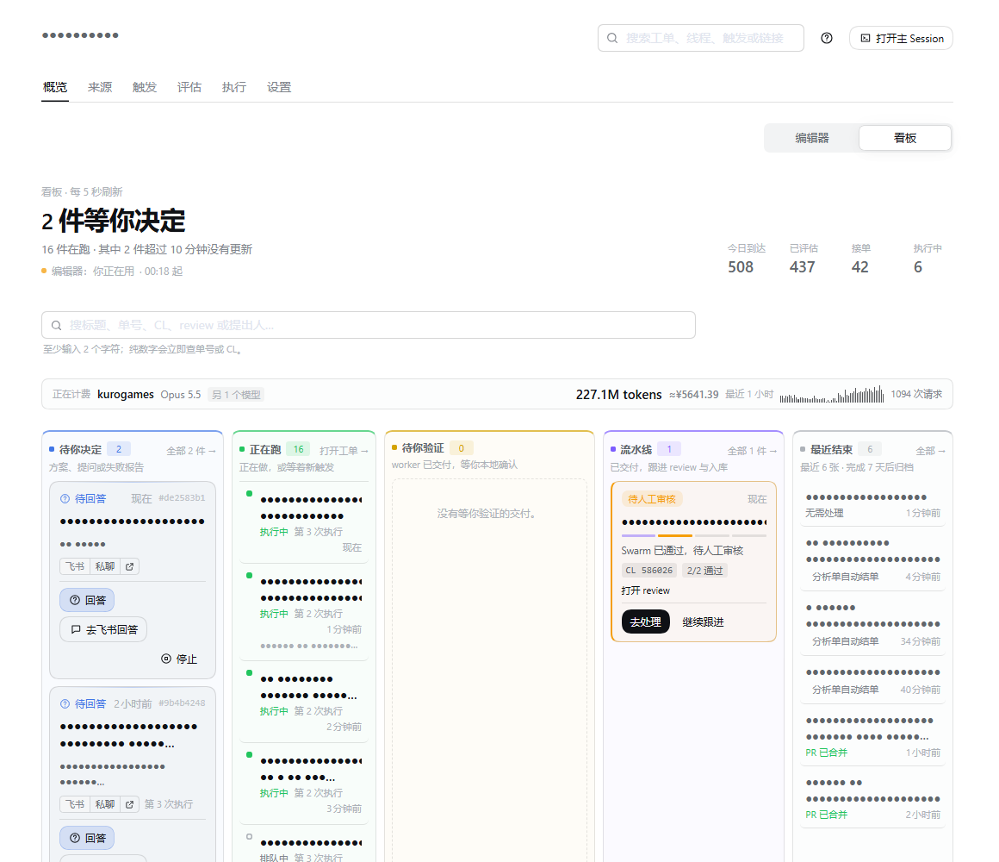
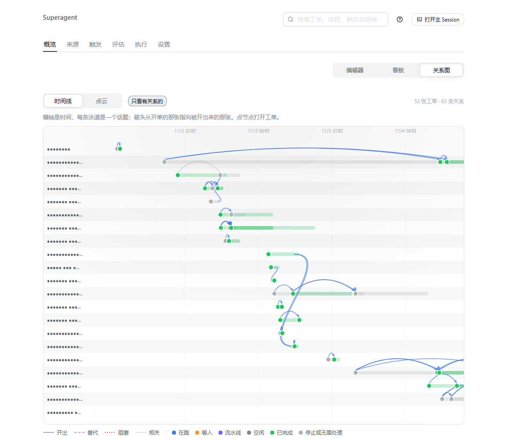
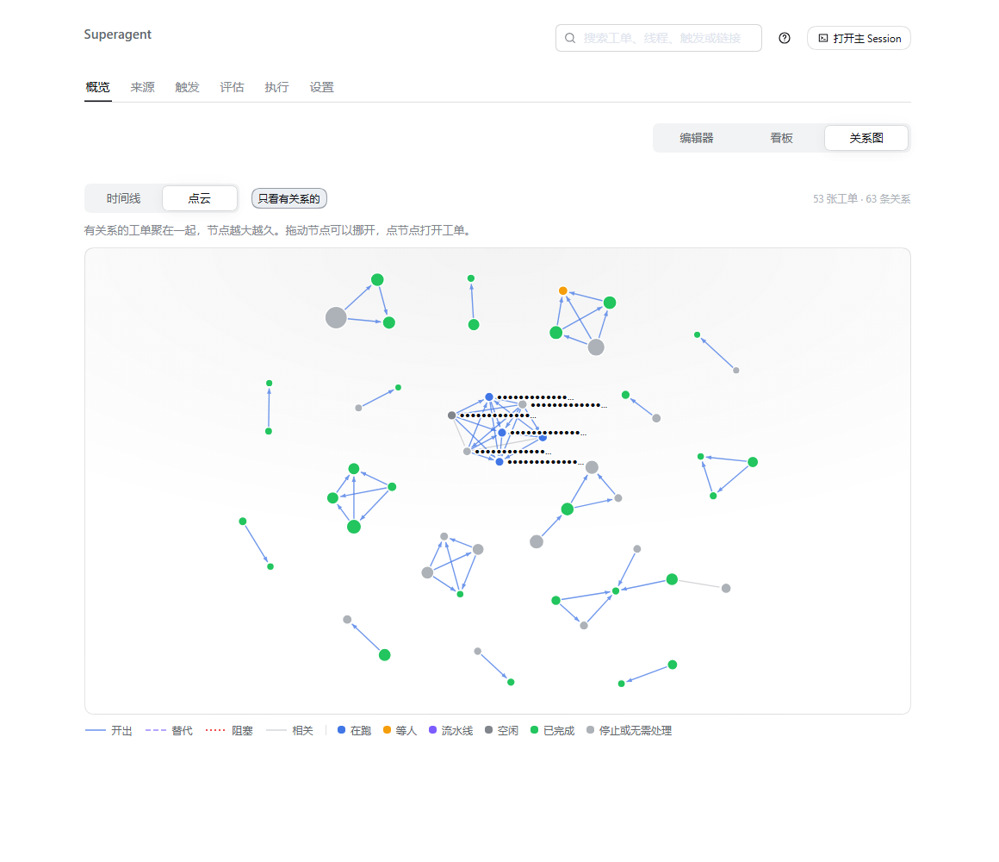
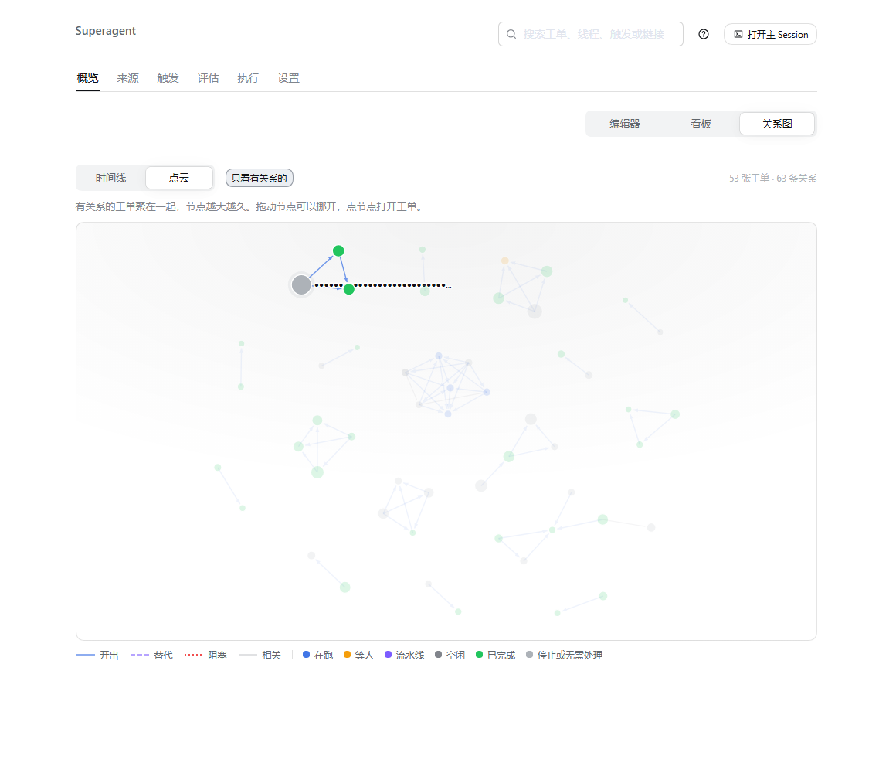

# Ticket relation view: timeline DAG and cloud

Captured from the live Superagent panel (`http://127.0.0.1:3082`, 概览) on 2026-11-05 between 02:28 and 02:45 +08:00,
headless Chrome (`--headless=new`), viewport 1440 × 1000 CSS px at DPR 1, light theme, clipped to the panel page. Every
Ticket title, lane name and relation reason is replaced with `●` before each capture, so no Feishu content appears.

- **Before** — the deployed `dsh-superagent` client bundle (`lib/client.js`, SHA-256 `E53BA276…`, built from `62a7212`,
  origin/main), 概览 → 看板. The switch offers 编辑器 and 看板 only; nothing shows how Tickets started one another.
- **After** — this branch's built client (`lib/client.js`, SHA-256 `157C9A7D…`), spliced into the served plugin batch through
  CDP `Fetch` interception, in the same page. The live host still runs the deployed server, which has no
  `GET tickets/graph`; that one response was answered from `ticketGraph()` of this branch run over a read-only snapshot of
  the live database taken at 02:24 (122 Tickets, 60 `spawned` edges from hand-backs, 3 split, 3 same-Thread). Every other
  request went to the live host. No file of the deployment was changed and it was not restarted.

| | Image |
| --- | --- |
| Before: 概览 → 看板 |  |
| After: 关系图 → 时间线 |  |
| After: 关系图 → 点云 |  |
| After: 点云, pointer on a Ticket |  |

With **只看有关系的** on (the default), the view shows 53 Tickets and 63 relations. No `supersedes` or `blocks` edge exists
yet in the live data: those are recorded from now on by workers with `orchestrator_ticket_link`; the panel tests cover how
they are drawn.
